## 1 导出网表

在 OrCAD Capture 中选择 **Tools → Create Netlist**，生成供 PCB 使用的网表。

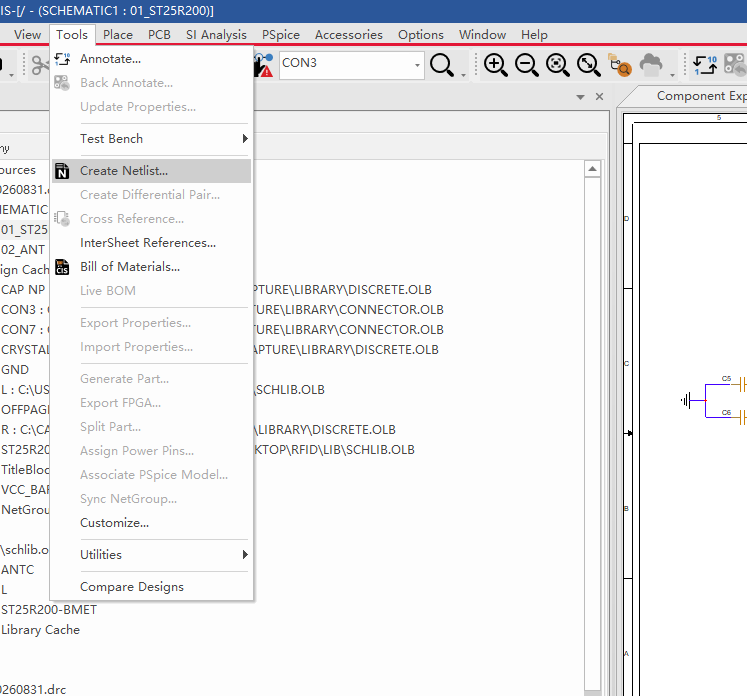

导出后，在 **allegro** 文件夹中可以看到 `pstchip.dat`、`pstxnet.dat`、`pstxprt.dat` 等网表文件，后续导入时选择这个文件夹。

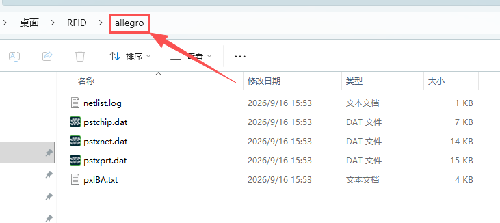

## 2 新建 PCB 文件

打开 OrCAD PCB Designer，选择 **File → New**，设置保存目录和文件名，**Drawing Type** 选择 **Board**，点击 **OK** 新建 `.brd` 文件。

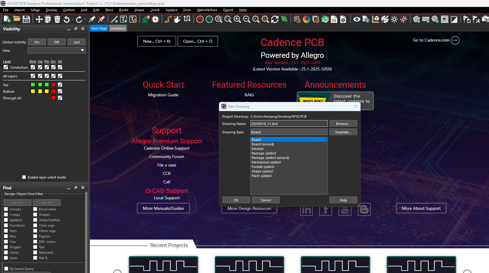

## 3 导入网表

在 PCB 软件中选择 **Import → Netlist**，打开网表导入窗口。

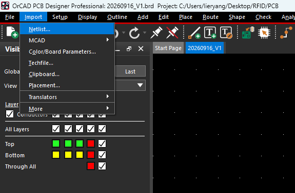

选择 **Design Entry CIS (Capture)**，将 **Import directory** 指向前面生成的 **allegro** 文件夹，点击 **Import** 导入。

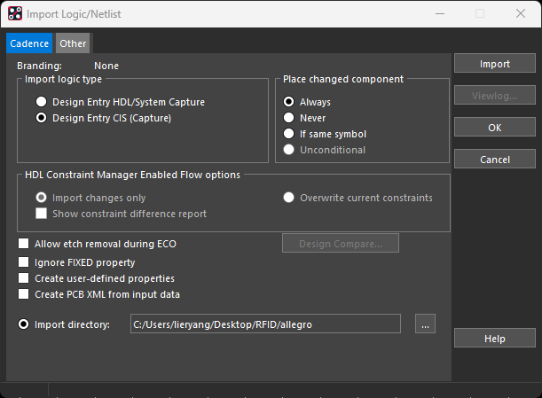

## 4 快速放置器件

导入完成后，选择 **Place → Quickplace**，将器件封装放到 PCB 画布中。

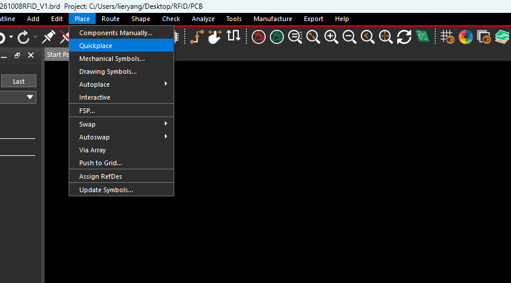

在 Quickplace 中选择器件范围和放置方式，点击 **Place** 执行。需要放置全部器件时，可以选择 **Place all components**；**Board layer** 用来选择放置层。

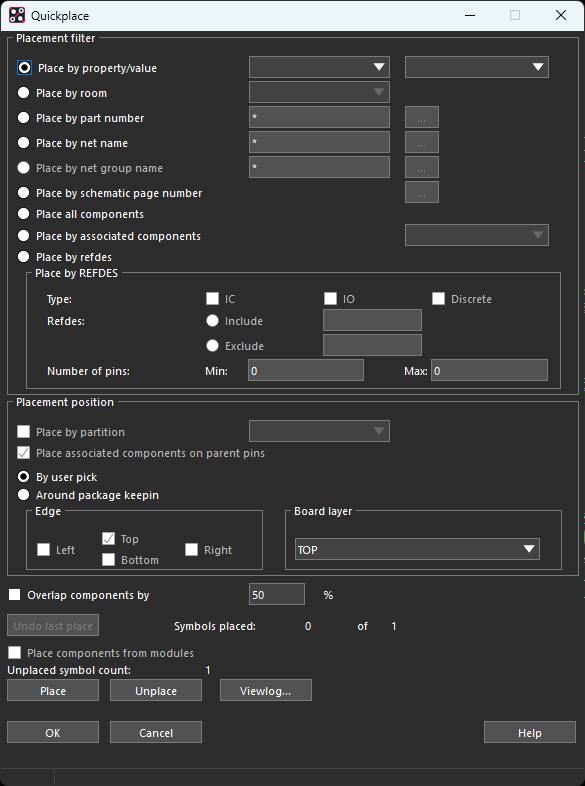

## 5 设置单位和工作区

选择 **Setup → Design Parameters → Design**，在 **User units** 中设置单位，图中使用的是 **Millimeter（毫米）**。

**Extents** 设置可操作的工作区范围：**Left X / Lower Y** 为左下角坐标，**Width / Height** 为宽度和高度。左下角设为负值，可以在原点左侧和下方操作；这里设置的是工作区范围，不是 PCB 板框尺寸。

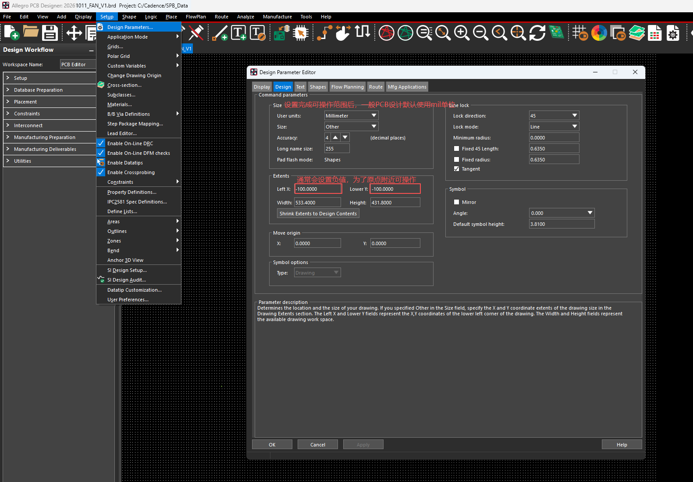

## 6 设置栅格

选择 **Setup → Grids**，勾选 **Grids On** 显示栅格。**Spacing X / Y** 设置横向、纵向间距，**Offset X / Y** 设置栅格偏移。

**Non-Etch** 用于器件放置等非铜层操作，**All Etch** 用于统一设置铜层栅格，也可以单独设置 **TOP / BOTTOM**。数值单位跟随 **User units**，例如 `5` 在 mil 单位下表示 5 mil，在毫米单位下表示 5 mm。

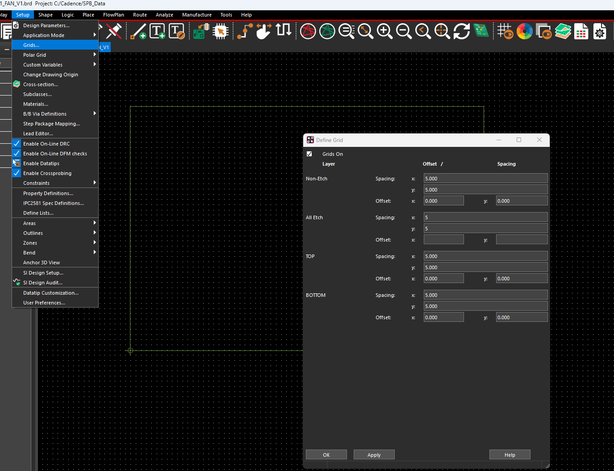

## 7 显示栅格和原点

选择 **Setup → Design Parameters → Display**，勾选 **Grids on** 显示栅格，勾选 **Design origin** 显示设计原点 `(0, 0)`。

红框中的 **Enhanced display modes** 用于控制孔、焊盘、连接点、DRC 标记等的显示，例如 **Filled pads** 表示实心显示焊盘，**Waived DRCs** 表示显示已豁免的 DRC 标记。

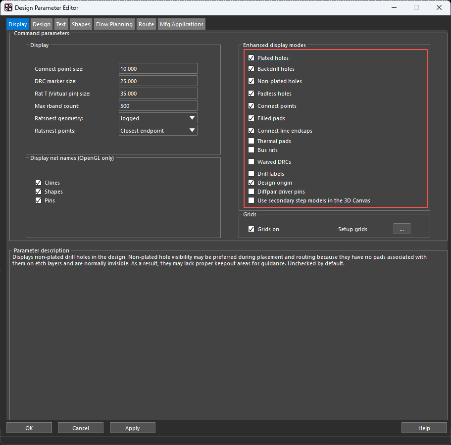

## 8 设置文字尺寸

选择 **Setup → Design Parameters → Text**，点击 **Setup text sizes** 右侧的 `…`，打开 **Text Setup**，可设置丝印等文字使用的尺寸。

**Text Blk** 是文字样式编号；**Width / Height** 是字符宽度和高度；**Line Space** 是行间距；**Photo Width** 是笔画宽度；**Char Space** 是字符间距。尺寸单位同样跟随 **User units**。

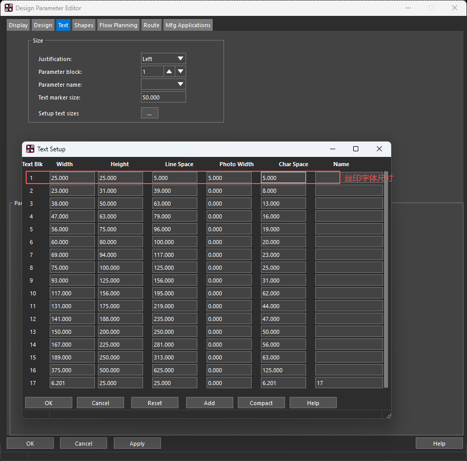
