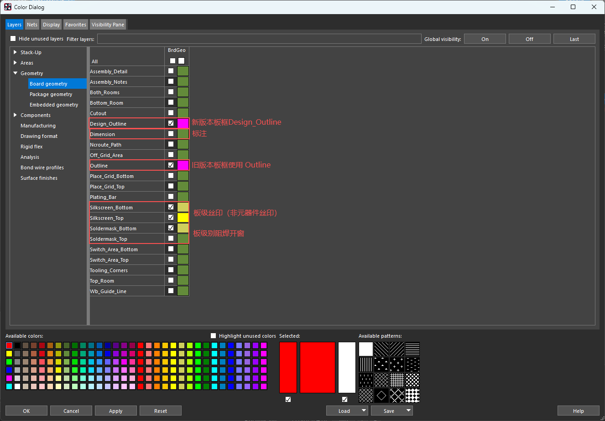
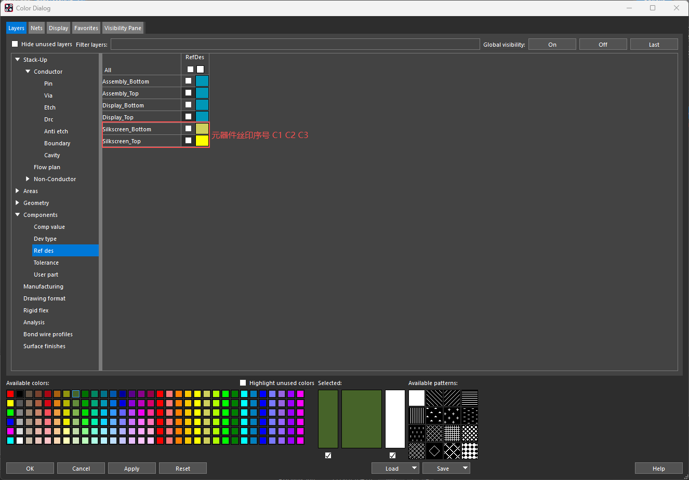

## 1 Geometry 几何分类

| 类别 | 中文含义 | 常见用途 |
| --- | --- | --- |
| `Board Geometry` | 板级几何图形 | PCB板框、板级丝印、尺寸标注、板内挖空、板级阻焊开窗等 |
| `Package Geometry` | 元器器件封装几何图形 | 元件封装丝印、元件Pin_Number、装配外形、器件占用边界等 |
| `Embedded Geometry` | 嵌入式器件几何图形 | 放置在 PCB 内部的器件所使用的几何信息，例如嵌入介质层中的电容等特殊设计 |

## 2 Components

`Components` 是 Color Dialog 中管理**元器件信息文字**的分类入口。展开后，每个项目对应一个 Class，可以分别设置其文字的显示颜色和可见性。

| 界面项目 | 对应 Class | 中文含义 | 内容示例 |
| --- | --- | --- | --- |
| `Comp value` | `Component Value` | 器件参数值 | 电阻的 `10k`、电容的 `100nF` 等 |
| `Dev type` | `Device Type` | 器件类型／定义名 | 网表中的器件类型名称，可能包含型号、封装等信息 |
| `Ref des` | `Ref Des` | 器件位号（Reference Designator） | `R1`、`C1`、`U1`、`J1` 等，用来定位具体器件 |
| `Tolerance` | `Tolerance` | 器件参数容差 | 电阻精度 `±1%`、`±5%` 等 |
| `User part` | `User Part Number` | 用户或公司的器件料号 | 企业物料编码、个人库中的器件编号等 |

### 2.1 Ref Des 的常见子类

截图选中的是 `Components → Ref des`。右侧各行是 `Ref Des` 下的 Subclass，用来区分位号文字所在的板面及用途：

| Subclass | 用途 |
| --- | --- |
| `Silkscreen_Top` | 顶层丝印位号 |
| `Silkscreen_Bottom` | 底层丝印位号 |
| `Assembly_Top` | 顶层装配图位号，用于装配、检验和定位器件 |
| `Assembly_Bottom` | 底层装配图位号，用于装配、检验和定位器件 |
| `Display_Top` | 顶面的辅助显示位号，通常用于编辑查看 |
| `Display_Bottom` | 底面的辅助显示位号，通常用于编辑查看 |

在封装 `.dra` 中，位号文字可以是 `REF` 等占位内容；导入网表并放置器件后，PCB 中显示实际位号，例如 `R1`、`C1`。显示某一类文字时，勾选相应行的复选框；修改其颜色时，选择颜色再点击对应色块，最后点击 `Apply` 或 `OK`。

## 3 同名不同Class

### 3.1 Silkscreen_Top

同样叫 `Silkscreen_Top`，放在不同 Class 中，表示的内容也不同：

| Class / Subclass | 内容示例 |
| --- | --- |
| `Board Geometry / Silkscreen_Top` | 板名、版本号、Logo、接口说明等板级丝印 |
| `Package Geometry / Silkscreen_Top` | 电阻、芯片、连接器等封装自身的丝印外形线 |
| `Ref Des / Silkscreen_Top` | R1、C1、U1 等器件位号；属于 Ref Des 类 |

顶层丝印输出通常需要合并板级文字、封装外形和器件位号。Color Dialog 中的可见性与 Artwork 中的输出内容分别设置，显示某一项并不代表它已加入制造文件。[Cadence 制造输出示例](https://resources.academic.cadence.com/pcb-design-and-analysis-resources/2024-how-to-generate-gerber-files-in-orcad-x-cadence)

下面统一以顶面 `_Top` 为例；带 `_Bottom` 的对应子类用于底面。判断用途时应看完整的 **Class / Subclass**。

### 3.2 Soldermask_Top

`Soldermask_Top` 是顶层阻焊开窗数据。在常规阻焊输出中，开窗图形表示不覆盖阻焊油的区域；其尺寸可以与铜焊盘不同。

| Class / Subclass | 内容示例 |
| --- | --- |
| `Pin / Soldermask_Top` | 器件引脚焊盘的开窗，由 `.pad` 文件定义，例如电阻、电容两个焊盘各自的开口 |
| `Via Class / Soldermask_Top` | 过孔的阻焊开口，由过孔 Padstack 定义；是否开窗按盖油、开窗等工艺要求设置 |
| `Package Geometry / Soldermask_Top` | 封装额外绘制的特殊开窗，例如在器件附近定义一整块开窗区域 |
| `Board Geometry / Soldermask_Top` | 板级局部开窗，例如需要露铜的走线或铜面区域 |

普通器件焊盘的开窗属于 Pin 的 Padstack，因此显示在 `Pin / Soldermask_Top`。在封装中放置一个 Pin 时，其铜焊盘、阻焊开口和钢网开口随该 Pin 一起放置；无需再到 Package Geometry 重复绘制普通焊盘开窗。

### 3.3 Pastemask_Top

`Pastemask_Top` 是顶层钢网开口数据，用来确定印刷锡膏的位置、面积和形状。它与 `Soldermask_Top` 分别定义：阻焊开口决定哪里不覆盖阻焊油，钢网开口决定哪里印锡膏。

| Class / Subclass | 内容示例 |
| --- | --- |
| `Pin / Pastemask_Top` | 器件焊盘对应的钢网开口，由 `.pad` 文件定义，可等大、缩小或偏移 |
| `Via Class / Pastemask_Top` | 过孔 Padstack 中定义的钢网图形；普通过孔通常无需印锡膏，不应仅因存在此子类就添加开口 |
| `Package Geometry / Pastemask_Top` | 封装中的特殊钢网图形，例如 QFN 散热焊盘上分割成多个小窗口的开口 |
| `Board Geometry / Pastemask_Top` | 板级附加钢网图形，较少使用；需确认设计中有相应子类并将其加入钢网输出 |

常规贴片电阻、电容主要使用 `Pin / Pastemask_Top`。特殊分割开口可绘制在 `Package Geometry / Pastemask_Top`；这时应检查并清空该焊盘原有的整块 Pastemask 图形（设为 `NULL`），避免整块开口覆盖分割设计

### 3.4 Assembly_Top

`Assembly_Top` 用于顶面装配图。不同 Class 中的外形、位号和参数文字可以组合成完整的装配资料。

| Class / Subclass | 内容示例 |
| --- | --- |
| `Package Geometry / Assembly_Top` | 器件装配外形，例如电阻本体、芯片轮廓及方向标记 |
| `Ref Des / Assembly_Top` | 装配图中的器件位号，例如 `R1`、`U1`，常放在器件外形内部 |
| `Component Value / Assembly_Top` | 装配图中需要显示的参数值，例如 `10k`、`100nF`；需存在相应文字对象 |
| `Board Geometry / Assembly_Top` | 板级装配辅助图形 |

装配图用于指导装配、定位和检验器件；实际印在板上的丝印则由相应的 `Silkscreen_Top` 数据输出。二者外形和文字位置可以不同，例如装配位号放在器件中心，丝印位号放在器件旁边。[装配与丝印输出分类](https://www.nordcad.dk/download/nsware/nsware_macaos.pdf)

### 3.5 Display_Top

同样叫 `Display_Top`，在元器件信息类中，表示不同内容的辅助显示文字：

| Class / Subclass | 内容示例 |
| --- | --- |
| `Ref Des / Display_Top` | 辅助显示的位号，例如 `R1`、`C1` |
| `Component Value / Display_Top` | 辅助显示的参数值，例如 `10k`、`100nF` |
| `Device Type / Display_Top` | 辅助显示的器件类型或定义名 |
| `Tolerance / Display_Top` | 辅助显示的容差，例如 `±1%` |
| `User Part Number / Display_Top` | 辅助显示的用户或公司料号 |

这些文字通常用于编辑查看，不会因为在画布上显示就自动成为实物丝印。想输出某类文字，需要在相应 Artwork 中明确包含它。器件有某项属性，也不等于已经放置了该属性的文字标签。

