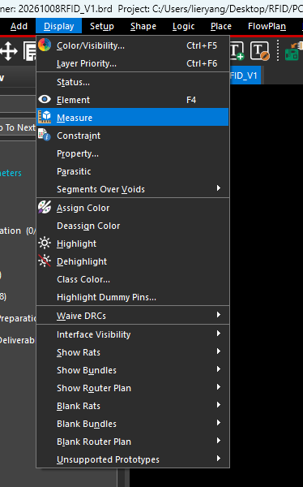
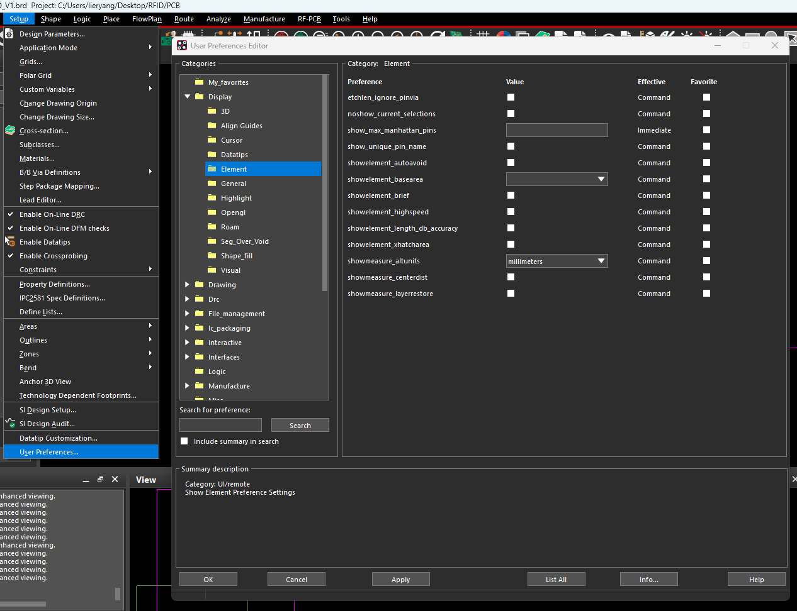
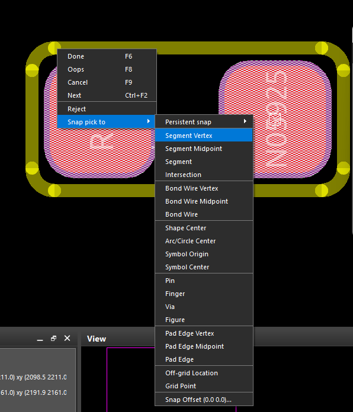
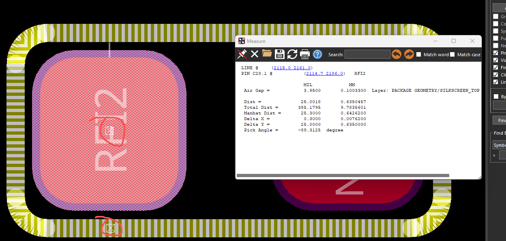

## 1 测量入口与基本操作

选择 **Display → Measure**，进入距离测量命令；也可以在命令窗口输入 `show measure`。它可以查看两个拾取点的距离、水平／垂直分量，以及两个对象之间的最小边缘间距。

基本操作：

1. 进入 `Display → Measure`。
2. 在右侧 `Find` 中选择需要测量的对象类型。
3. 点击第一个对象或定位点，结果窗口显示对象信息和坐标。
4. 点击第二个对象或定位点，结果窗口显示本次测量值；需要精确定位时，使用右键 `Snap pick to`。
5. 测下一组时使用右键 `Next`；结束时使用右键 `Done`。

| Find 对象类型 | 常见测量对象 |
| --- | --- |
| `Pins` | 器件引脚焊盘，例如电阻、电容的 1、2 脚 |
| `Vias` | 过孔 |
| `Lines` | 丝印线、装配线等普通图形线 |
| `Clines / Cline Segs` | 电气走线及其线段 |
| `Shapes` | 铜皮、闭合区域等 Shape 对象 |

## 2 同时显示 mil 和 mm

进入 **Setup → User Preferences → Display → Element**，设置 `showmeasure_altunits`：

- 当前设计单位为 `Mils`：附加单位选择 `millimeters`。
- 当前设计单位为 `Millimeters`：附加单位选择 `mils`。
- 点击 `Apply / OK`，退出后重新执行测量。

截图中设置的是 `showmeasure_altunits = millimeters`，测量报告会同时出现 `MIL` 和 `MM` 两列。

## 3 Snap pick to 精确捕捉

测量命令中，将鼠标移到目标附近，右键选择 **Snap pick to → 捕捉方式**，可以把拾取点精确定位到端点、中点、圆心、引脚定位点或焊盘边缘等位置。

普通 `Snap pick to` 通常作用于一次拾取；`Persistent snap` 用于持续采用某种捕捉方式。捕捉会按指定的对象类型，在鼠标附近寻找可见、可用的目标，其类型选择优先于普通 Find 过滤设置。目标不可见、鼠标离目标太远或附近没有对应对象时，捕捉可能失败。

### 3.1 截图中全部 Snap 选项

| 菜单项 | 中文含义 | 功能与使用场景 |
| --- | --- | --- |
| `Persistent snap` | 持续捕捉 | 在子菜单中选择一种捕捉方式，后续拾取持续采用它；例如连续测多个焊盘的引脚定位点。它是模式设置，不是一个几何点 |
| `Segment Vertex` | 线段顶点／端点 | 捕捉支持对象中离鼠标最近的线段顶点；适合拾取线段端点、折线拐点 |
| `Segment Midpoint` | 线段中点 | 捕捉目标线段的中点；适合对齐或测量两条边的中部位置 |
| `Segment` | 线段上的最近点 | 捕捉线段上距离鼠标最近的位置；落点可以在段内，并不限定为端点或中点 |
| `Intersection` | 交点 | 捕捉支持的线段之间的交点，例如两条定位线组成的十字交点 |
| `Bond Wire Vertex` | 键合线顶点 | 捕捉键合线的顶点／折点，主要用于 IC 封装的 Wire Bond 设计 |
| `Bond Wire Midpoint` | 键合线段中点 | 捕捉键合线段中点，主要用于键合线几何测量和定位 |
| `Bond Wire` | 键合线上的最近点 | 捕捉键合线对象上的附近位置，主要用于 IC 封装设计 |
| `Shape Center` | Shape 中心 | 捕捉闭合 Shape 对象的中心；适用于区域、铜皮等对象的中心定位 |
| `Arc/Circle Center` | 圆弧／圆心 | 捕捉圆弧或圆的圆心；适合测量圆形图形的中心间距 |
| `Symbol Origin` | 封装原点 | 捕捉封装定义的原点；原点由建库时设定，可以位于本体中心，也可以位于其他位置 |
| `Symbol Center` | 封装中心 | 捕捉符号的中心；对于原点设在 1 脚等位置的封装，它与 `Symbol Origin` 可能不同 |
| `Pin` | 引脚定位点 | 捕捉最近 Pin 的定位点／原点；普通居中焊盘通常以此测量焊盘中心距，带偏移的 Padstack 要确认几何中心是否与 Pin 原点一致 |
| `Finger` | 键合指定位点 | 捕捉最近 Bond Finger 对象的连接定位点，主要用于 IC 封装的键合连接 |
| `Via` | 过孔定位点 | 捕捉最近过孔的定位点，通常位于过孔中心；适合测量孔距 |
| `Figure` | Figure 图形对象 | 捕捉软件识别的最近 Figure 图形／标记对象；是否可捕捉取决于附近是否存在相应对象 |
| `Pad Edge Vertex` | 焊盘边缘顶点 | 捕捉焊盘边界的最近顶点；圆角焊盘取的是其边界几何顶点，不能当作已去掉的直角角点 |
| `Pad Edge Midpoint` | 焊盘边缘段中点 | 捕捉焊盘某一边界段的中点；测矩形或圆角矩形焊盘宽高时，可选择相对的平直边中点 |
| `Pad Edge` | 焊盘边缘最近点 | 捕捉焊盘轮廓上离鼠标最近的位置；适合拾取指定的边缘点 |
| `Off-grid Location` | 非栅格位置 | 直接采用鼠标拾取的位置，不进行栅格对齐；适用于需要自由选点的情况 |
| `Grid Point` | 栅格点 | 捕捉离鼠标最近的栅格点；精度和位置受当前栅格设置影响 |
| `Snap Offset (0.0 0.0)…` | 捕捉偏移 | 在所选捕捉目标的基础上增加偏移；可用 X/Y 或距离／角度定义偏移，数值按当前单位解释 |

### 3.2 持续捕捉与偏移

- 需要临时换一次捕捉方式时，使用普通的 `Snap pick to` 项目。
- 需要连续使用同一种方式时，在 `Persistent snap` 子菜单中选择该方式。
- `Snap Offset` 是在目标点的基础上增加偏移。例如以圆心为目标，再指定 X/Y 偏移，会得到偏移后的拾取点。
- 持续捕捉启用后，偏移值也可能在后续命令中继续使用。测量真实原点、中心或端点时，应确认偏移为零。

不要把 `Segment` 与 `Segment Midpoint` 混淆：前者取最近点，后者取固定中点。`Pin` 与 `Pad Edge` 也不同，前者取引脚定位点，后者取焊盘轮廓位置。

## 4 测量结果窗口

截图中拾取的是一段 `LINE` 和 `PIN C28.1`。顶部列出两者的拾取坐标，下面分别以 `MIL` 和 `MM` 显示测量结果。

| 字段 | 功能 | 截图中的数值／说明 |
| --- | --- | --- |
| `Air Gap` | 两个对象之间的最小边缘间距，计算会考虑参与测量的对象几何 | `3.9500 mil = 0.1003300 mm`，约 0.10 mm |
| `Dist` | 两个拾取标记点之间的直线距离 | `25.0018 mil = 0.6350457 mm` |
| `Total Dist` | 当前测量序列累计的 Dist；选 Next 后重新起算 | `385.1795 mil = 9.7835601 mm`，包含此前的测量累计值 |
| `Manhat Dist` | 曼哈顿距离，即水平距离与垂直距离的绝对值之和 | `25.3000 mil = 0.6426200 mm` |
| `Delta X` | 两个标记点的水平距离大小 | `0.3000 mil = 0.0076200 mm` |
| `Delta Y` | 两个标记点的垂直距离大小 | `25.0000 mil = 0.6350000 mm` |
| `Pick Angle` | 两个标记点连线的角度，符号与选点方向有关 | `-89.3125 degree`，接近垂直方向 |
| `Layer / On Subclass` | 参与测量的层或共同子类信息；显示形式取决于对象 | 图中为 `PACKAGE GEOMETRY/SILKSCREEN_TOP`，应结合顶部对象信息判断测量对象 |

