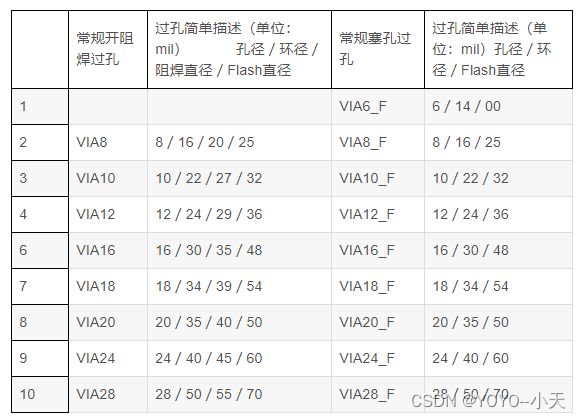
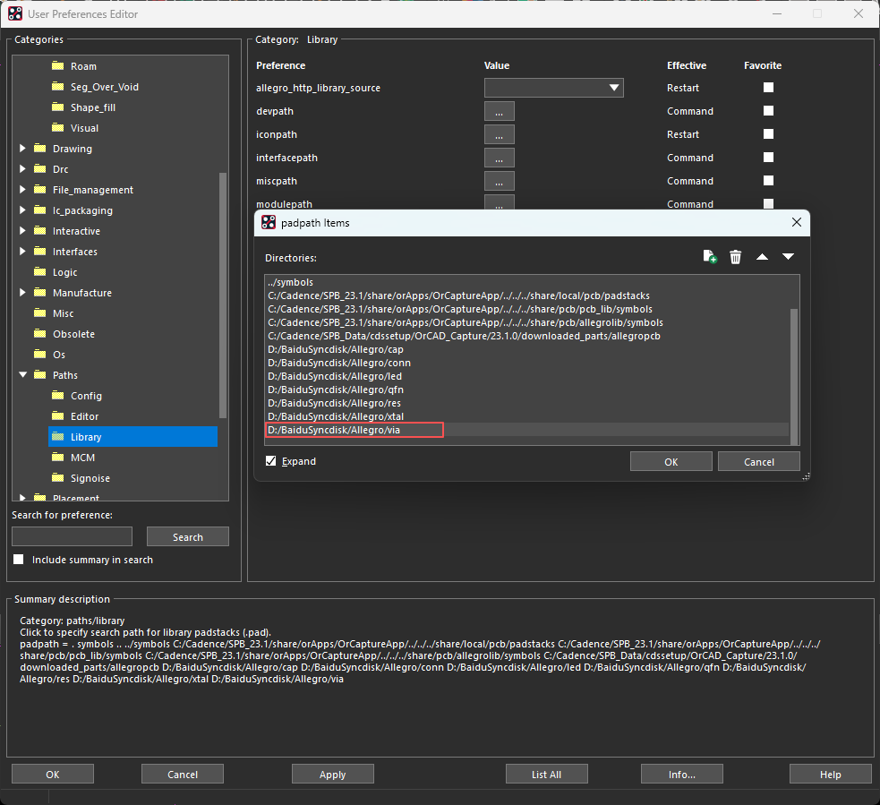
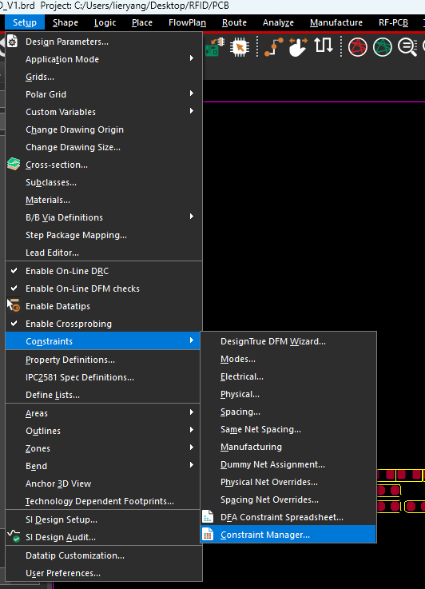
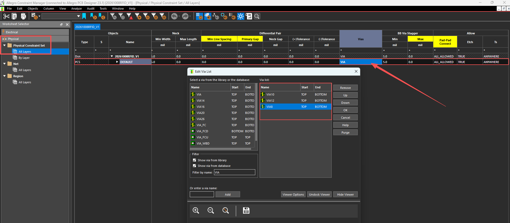
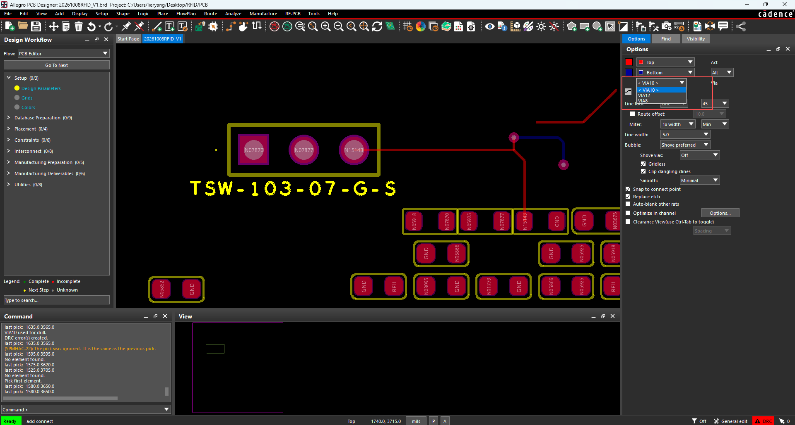

## 1 认识过孔尺寸

过孔（Via）用于连接不同铜层。普通通孔过孔的孔壁镀铜，穿过整块 PCB；孔径、铜盘外径、阻焊开口和铜皮隔离开口是不同的尺寸，不能混在一起。



这张图是另一套封装库的尺寸参考，表头中的“孔径／环径／阻焊直径／Flash 直径”分别描述不同部分。它不代表本机当前过孔库的完整参数。

| 参数 | 含义 | 判断方法 |
| --- | --- | --- |
| 孔径 / Drill diameter | 名义成品孔直径，也就是通常说的内径 | 在 Padstack Editor 的 `Drill` 页查看 |
| 铜盘外径 / Regular Pad | 铜盘的整体直径，包含孔；图中“环径”按铜盘外径理解 | 在 `Design Layers → Regular Pad` 查看 |
| 单边铜环 / Annular ring | 孔边缘到铜盘边缘的宽度 | `(铜盘外径 − 孔径) ÷ 2` |
| 阻焊开口 / Soldermask | 允许露铜的窗口 | 在 `Mask Layers` 查看；双面盖油版顶底均为 `None / NULL` |
| Anti Pad | 过孔与不同网络铜皮之间的隔离开口 | 若按此定义避让，单边铜到铜间距为 `(Anti Pad 直径 − 铜盘外径) ÷ 2` |
| Thermal Pad / Flash | 同网络铜皮采用热隔离连接时使用的定义 | 需要结合 Shape 参数和所引用的 Flash 图形判断，不能仅凭直径推断连接方式 |

截图中的 `_F` 是那套库自己的命名后缀，不是 Allegro 自动识别塞孔工艺的标准。盖油、油墨塞孔、树脂填孔等还需要在制造说明与板厂订单中明确。

### 本机当前过孔库

目录为 `D:/BaiduSyncdisk/Allegro/via`，所有文件按 **mil 单位**定义，内部名称与文件名一致，均为**镀铜通孔、双面盖油、无钢网开口**。

| 文件 | 孔径 mil | 铜盘外径 mil | 单边铜环 mil | Anti Pad 直径 mil |
| --- | ---: | ---: | ---: | ---: |
| `via8.pad` | 8 | **16** | **4** | **32** |
| `via10.pad` | 10 | 22 | 6 | 38 |
| `via12.pad` | 12 | 24 | 6 | 40 |
| `via14.pad` | 14 | 26 | 6 | 42 |
| `via16.pad` | 16 | 28 | 6 | 44 |
| `via20.pad` | 20 | 36 | 8 | 52 |

`via8` 已从 8／20 mil 改为 **8／16 mil**；不是只改名称，实际铜盘尺寸也已重新生成。以它为例：孔径 8 mil，铜盘直径 16 mil，单边铜环为 `(16 − 8) ÷ 2 = 4 mil`。当前 Anti Pad 为 32 mil，对应单边铜到铜隔离 8 mil。

`1 mil = 0.0254 mm`，所以 `via8` 的孔径是 0.2032 mm、铜盘外径是 0.4064 mm。选用尺寸时按板厚、铜厚、孔到铜间距和板厂能力核对，不把这张表当作所有工艺的统一最低要求。

## 2 添加过孔库路径

选择 **Setup → User Preferences → Paths → Library**，找到 `padpath`，点击值右侧的 `…`，进入路径列表。



1. 点击带绿色加号的文件夹按钮，添加 `D:/BaiduSyncdisk/Allegro/via`。
2. 确认路径存在，里面能看到 `via8.pad`、`via10.pad` 等文件。
3. 点击列表窗口的 `OK`，再点击 User Preferences 的 `Apply / OK`。

| 项目 | 功能 |
| --- | --- |
| `padpath` | 搜索 `.pad` 焊盘叠层，包括器件引脚焊盘和过孔 |
| `psmpath` | 搜索封装符号及相关符号文件；单独的过孔 `.pad` 主要依赖 `padpath` |
| 添加文件夹 | 增加搜索目录 |
| 垃圾桶 | 从路径列表移除所选目录，不删除磁盘中的文件 |
| 上／下箭头 | 调整搜索顺序；同名文件出现在多个目录时，要注意实际使用的来源 |

**添加路径只是让 Allegro 找得到文件，还需要把过孔加入设计的 Via List，布线时才能按约束选用。**

## 3 打开约束管理器

选择 **Setup → Constraints → Constraint Manager**。也可从同一菜单的 `Physical…` 进入物理约束工作表。



在左侧展开：

```text
Physical
└─ Physical Constraint Set
   └─ All Layers
```

找到需要修改的 Physical CSet，例如截图中的 `DEFAULT`，点击或双击该行的 **Vias** 单元格，打开 `Edit Via List`。

## 4 设置允许使用的 Via List



左侧是可选的库文件／设计数据库中的过孔，右侧 `Via list` 是当前约束允许使用的过孔。

1. 在左侧按名称查找 `via8`、`via10`、`via12` 等。
2. 选择左侧条目，将需要的过孔加入右侧列表；可用 `Ctrl` 多选或 `Shift` 连续选择。
3. 右侧不需要的条目，用 `Remove` 移出列表。
4. 用 `Up / Down` 调整顺序，然后点击 `OK`。
5. 核对目标网络实际使用的 Physical CSet。如果网络或区域使用另一个 CSet，需要修改对应约束，不能仅修改 `DEFAULT`。

| 控件 | 功能 |
| --- | --- |
| `Show via from library` | 显示搜索路径中的过孔 |
| `Show via from database` | 显示当前设计数据库中的过孔 |
| `Filter by name` | 按名称过滤候选项；该字段支持正则表达式 |
| `Name` | Padstack 名称 |
| `Start / End` | 起始、终止铜层；通孔通常为 `TOP → BOTTOM` |
| `Via list` | 当前约束允许使用的过孔列表 |
| `Remove` | 从当前列表移除条目，不删除库文件或已经放置的过孔 |
| `Up / Down` | 改变列表顺序；多个通孔均符合条件时，路由器通常优先使用排在前面的条目 |
| `Or enter a via name / Add` | 手工加入名称；能加入名称不代表对应 `.pad` 已存在或已正确配置 |
| `View Options` | 调整下方预览的显示选项 |
| `Undock Viewer` | 将预览窗口分离出来 |
| `Hide Viewer` | 隐藏预览窗口 |
| `Purge` | 清理手工输入的非库过孔条目；弹窗可选择当前列表或所有列表，不是删除板上的过孔 |

截图右侧选了 `VIA10`、`VIA12`、`VIA8`。名称显示成大写不影响理解，但实际孔径、外径应以当前设计中加载的 Padstack 为准。

## 5 布线时选择和放置过孔

选择 **Route → Connect** 进入布线，也可以使用 `add connect` 命令。右侧 `Options` 会显示当前层、换层目标及可选过孔。



| Options 项目 | 含义 |
| --- | --- |
| `Act` | 当前正在布线的铜层，截图为 `Top` |
| `Alt` | 换层时使用的备用／目标铜层，截图为 `Bottom` |
| `Via` | 当前使用的过孔；下拉列表来自当前网络和区域适用的 Via List |
| `Line width` | 当前线宽，遵守所选网络的物理约束 |

基本操作：

1. 从需要连接的焊盘或走线开始布线。
2. 在 `Via` 下拉列表选择需要的过孔，例如 `via12`。
3. 确認 `Act / Alt` 对应需要连接的层。
4. 在线路需要换层的位置双击，插入过孔并继续在目标层布线；若弹出层选择菜单，选择实际目标层。
5. 完成连接后，右键 `Done` 退出命令。

截图中红色走线为顶层，蓝色走线为底层，换层位置用过孔连接。图中命令窗口曾出现 `DRC error(s) created`，说明放置或布线产生了规则错误；应查看 DRC 标记和具体规则，不能只看走线已经连接就认为检查通过。

## 6 Regular、Anti 和 Thermal 的区别

| 项目 | 解决的问题 | 当前库设置 |
| --- | --- | --- |
| `Regular Pad` | 定义实际铜盘，供走线和同网络铜皮连接 | 圆形，尺寸见上表 |
| `Anti Pad` | 定义与不同网络平面之间的隔离开口 | 圆形，铜盘直径 + 16 mil |
| `Thermal Pad` | 定义同网络平面中的热隔离连接，通常带铜桥 | `None / NULL` |

**这批库采用正片动态铜皮流程。** 在 Shape 参数中选择 `DRC Value` 时，避让按设计间距计算；选择 `Thermal/Anti` 时，参考 Padstack 的相应尺寸。正片动态铜皮的全连接或热隔离连接由 Shape 参数及对象属性控制，不能认为 `Thermal Pad=None` 就一定不能连接地铜。

普通盖油过孔无需焊接，通常可采用全连接；需要焊接的通孔器件引脚更常采用热隔离，以减少铜皮吸热。若设计采用负片平面层，需要按连接方式补充合适的 Thermal Flash（`.fsm`），当前库未提供这部分。

## 7 盖油、塞孔与四层板

| 项目 | 说明 |
| --- | --- |
| 双面盖油 | 顶底不设置阻焊开口，阻焊覆盖过孔表面，不要求填满孔 |
| 油墨塞孔 | 板厂把油墨压入孔内，是另一个制造工艺，不由 `NULL` 阻焊开口自动决定 |
| 树脂填孔＋铜盖帽 | 填孔后再做表面铜盖帽，可用于需要平整焊接表面的焊盘内过孔 |
| 通孔 | 贯穿整块板；当前 `via8～via20` 都是这一类型 |
| 盲孔 | 从一个表层连接到内层，不贯穿整板 |
| 埋孔 | 只连接内层，孔不露到板面 |

这批通孔可用于四层板：`BEGIN LAYER` 对应顶层，两个内层使用 `DEFAULT INTERNAL`，`END LAYER` 对应底层。穿过某层不表示自动连接该层所有铜皮，同网络连接、不同网络隔离仍由网络与铜皮规则决定。

双面盖油的制造效果还需结合孔径和工艺确认。`via20` 的孔径为 20 mil（0.5080 mm），盖油不代表一定能把整个孔口封住；下单时按板厂要求选择盖油或明确塞孔工艺。

## 8 修改库后与常见问题

**库文件改了，已经加载到 PCB 数据库里的同名 Padstack 不一定自动更新。** 本次 `via8` 铜盘已改为 16 mil，设计中使用旧版本时应刷新对应 Padstack，并检查孔径、Regular Pad、Anti Pad 和阻焊定义，再更新铜皮、运行 DRC。

| 问题 | 检查位置 |
| --- | --- |
| 左侧候选列表找不到过孔 | 核对 `padpath`、文件名、路径是否存在，以及库显示选项和名称过滤条件 |
| Via List 有名称，布线下拉列表没有 | 核对当前网络／区域使用的 CSet、过孔起止层和数据库加载状态 |
| 修改 `DEFAULT` 后部分网络没有变化 | 检查网络或区域是否使用其他 Physical CSet |
| 修改 Anti Pad 后铜皮避让没变化 | 核对 Shape 的间距来源是否为 `DRC Value`，以及是否存在局部覆盖属性 |
| 修改 `.pad` 后板上的铜盘仍是旧尺寸 | 刷新设计数据库中的同名 Padstack；Via List 只控制可选名称，不会直接替换现有尺寸 |
| 出现 DRC 标记 | 查看具体的铜到铜、孔到铜、孔到孔、Via List 等规则，再判断是否需要改尺寸或位置 |

参考：[Cadence Constraint Manager 使用说明](https://resources.academic.cadence.com/pcb-design-and-analysis-resources/2024-how-to-use-the-constraint-manager-in-orcad-x)、[Cadence Padstack 说明](https://community.cadence.com/cfs-file/__key/communityserver-discussions-components-files/137/MakePadstackInAllegroSkill.pdf)、[Cadence Thermal／Anti 使用说明](https://community.cadence.com/cadence_technology_forums/pcb-design/f/pcb-design/38834/pad-editor-thermal-pad-and-anti-pad-when-are-they-applicable)、[板厂过孔盖油与塞孔说明](https://jlcpcb.com/help/article/pcb-via-covering)。

