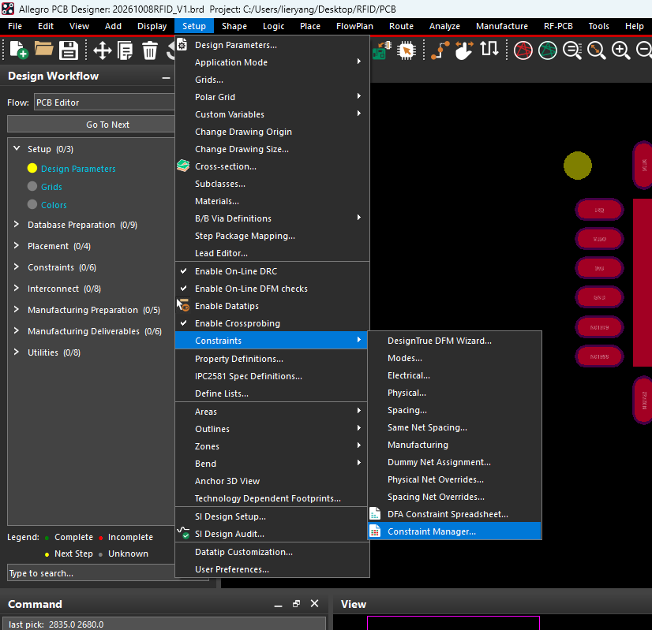
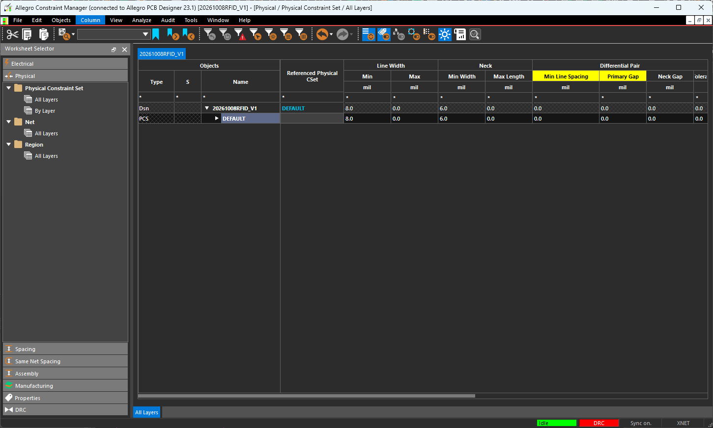
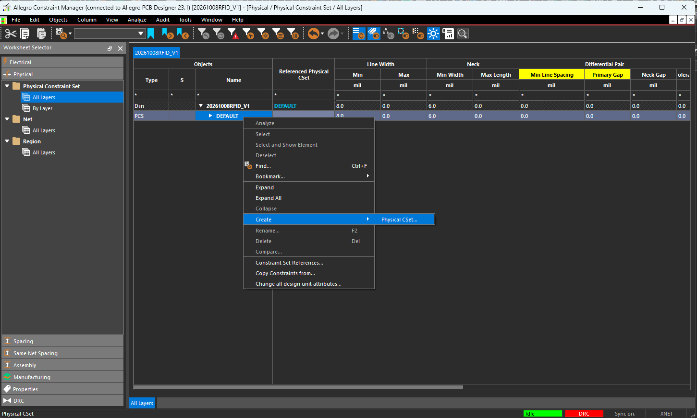
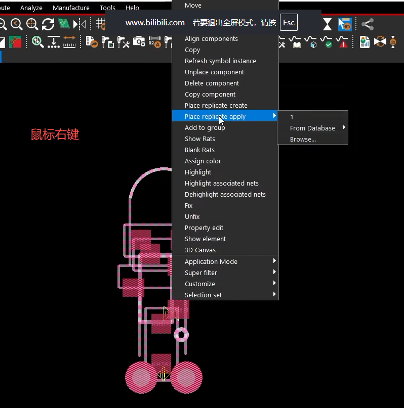
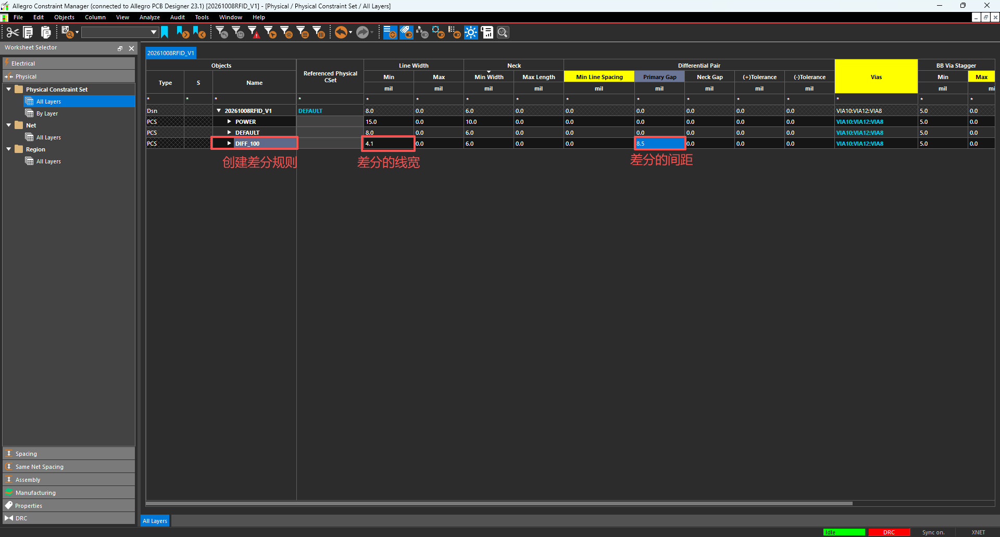
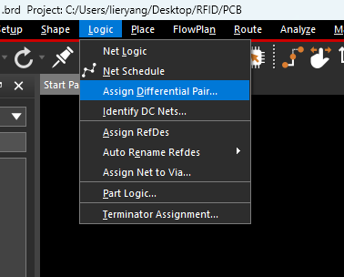
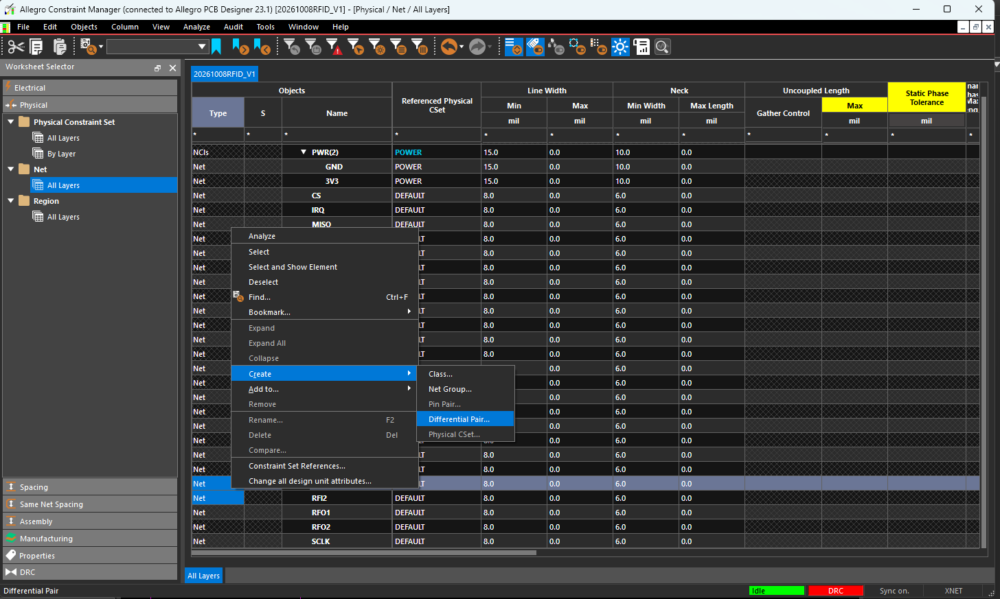
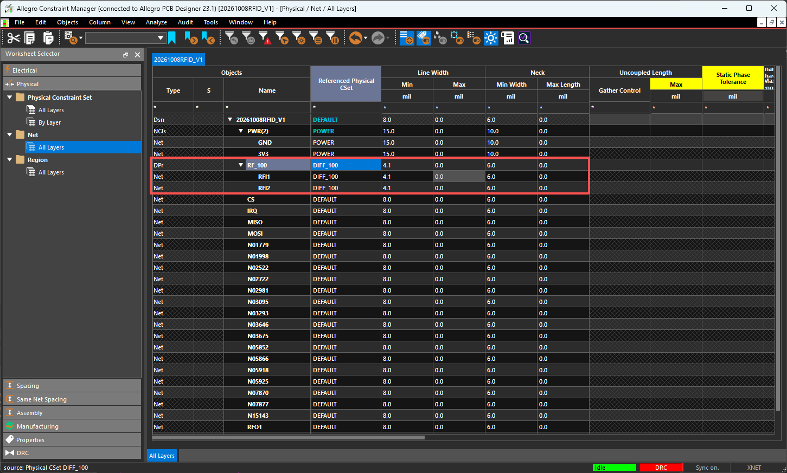
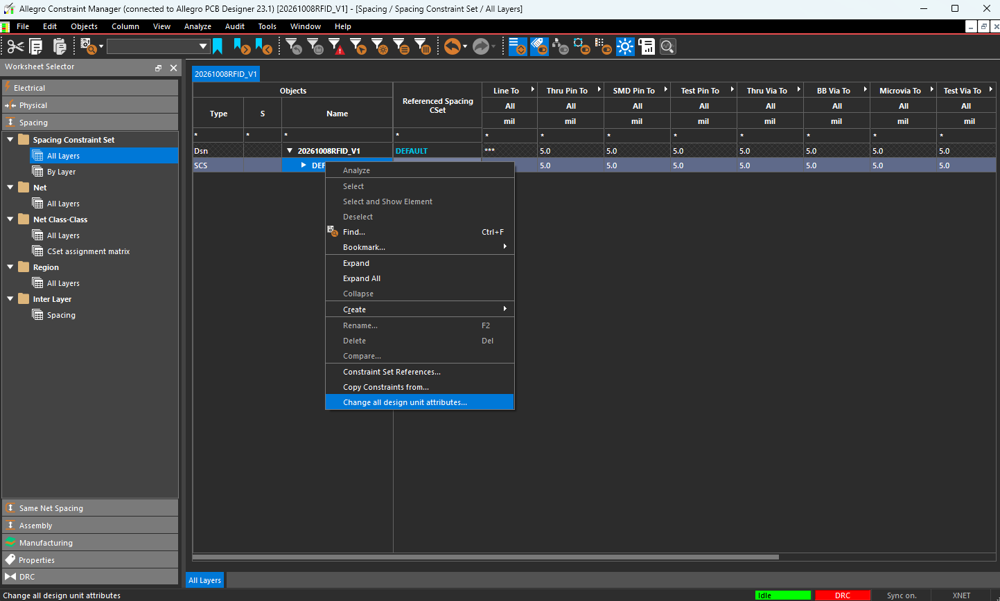

## 1 打开布线规则设置

选择 **Setup → Constraints → Constraint Manager…** 打开约束管理器。也可以直接选择同一菜单中的 `Physical…`，进入物理约束工作表。



| 菜单／约束域 | 主要用途 |
| --- | --- |
| `Electrical` | 电气性能约束，例如长度、时序和差分对相关电气要求 |
| `Physical` | 线宽、缩颈、过孔列表、差分对线宽与间距等物理规则 |
| `Spacing` | 不同网络对象之间的最小间距，例如线到线、线到过孔、线到焊盘 |
| `Same Net Spacing` | 同一网络对象之间需要检查的间距 |

截图中 `Enable On-Line DRC` 已勾选，表示编辑过程中启用在线设计规则检查。具体检查项仍需结合 Analysis Modes 核对。

## 2 找到默认物理约束集

在约束管理器左侧依次展开：

```text
Physical
└─ Physical Constraint Set
   └─ All Layers
```

在右侧找到 **`DEFAULT`** 行。CSet 是 Constraint Set 的缩写，表示一组可以重复分配的约束；`DEFAULT` 是默认物理约束集。




### 左侧几个工作表的区别

| 工作表 | 操作对象 | 使用场景 |
| --- | --- | --- |
| `Physical Constraint Set → All Layers` | 物理约束集 | 定义一套通用线宽、缩颈、过孔规则 |
| `Physical Constraint Set → By Layer` | 约束集在不同铜层上的值 | 设置顶层、底层或内层各自的规则 |
| `Net → All Layers` | 实际网络及其分组 | 查看网络最终使用的规则，分配 Physical CSet，或检查局部覆盖 |
| `Region → All Layers` | 约束区域 | 为局部密集布线区域设置规则 |


## 3 为不同网络建立不同规则

需要区分信号、电源或其他用途时，可以创建多套 Physical CSet，例如 `SIGNAL`、`POWER`。这些名称由自己定义。



图中先选中 `DEFAULT` 的名称单元格，再右键选择 **Create → Physical CSet…**。创建后需要检查新约束集的参数，不能只输入名称就认为已经完成了规则配置。




## 4 差分

先在 **Physical → Physical Constraint Set → All Layers** 中创建差分用的 Physical CSet。图中规则名为 `DIFF_100`，`Line Width → Min` 为单根线宽 **4.1 mil**，`Differential Pair → Primary Gap` 为两根线铜边到铜边的间距 **8.5 mil**。实际尺寸应按叠层和目标阻抗确定，规则名称本身不保证阻抗值。



创建差分对有两种方式，任选一种即可：

**方式一：**在 PCB 编辑器中选择 **Logic → Assign Differential Pair…**，指定需要配对的两个网络并命名。



**方式二：**在约束管理器的 **Physical → Net → All Layers** 中，按住 `Ctrl` 选中两个网络，右键选择 **Create → Differential Pair…**。



创建后，在差分对所在行的 **Referenced Physical CSet** 中选择 `DIFF_100`。图中差分对名为 `RF_100`，成员为 `RFI1` 和 `RFI2`；引用规则后，两条线使用该差分约束。



如果差分间距小于 `Spacing` 中的普通线间距，需要同时设置 **Differential Pair → Min Line Spacing**。不使用更小缩颈间距时，可设为与 `Primary Gap` 相同；若使用更小的 `Neck Gap`，则按实际允许的最小差分间距设置。该参数用于差分对内部，不会放宽差分对与其他网络的间距。

## 5 间距

进入 **Spacing → Spacing Constraint Set → All Layers**，修改 `DEFAULT`，或右键 **Create** 新建 Spacing CSet，设置不同网络间的最小铜到铜间距。



按需要分别设置线到线、线到焊盘、线到过孔、过孔到过孔等间距；展开对象列可查看具体组合。图中部分间距为 **5 mil**，仅为当前设计示例。新建规则后，还需在 **Spacing → Net → All Layers** 中分配对应的 Spacing CSet，最后检查 DRC。
