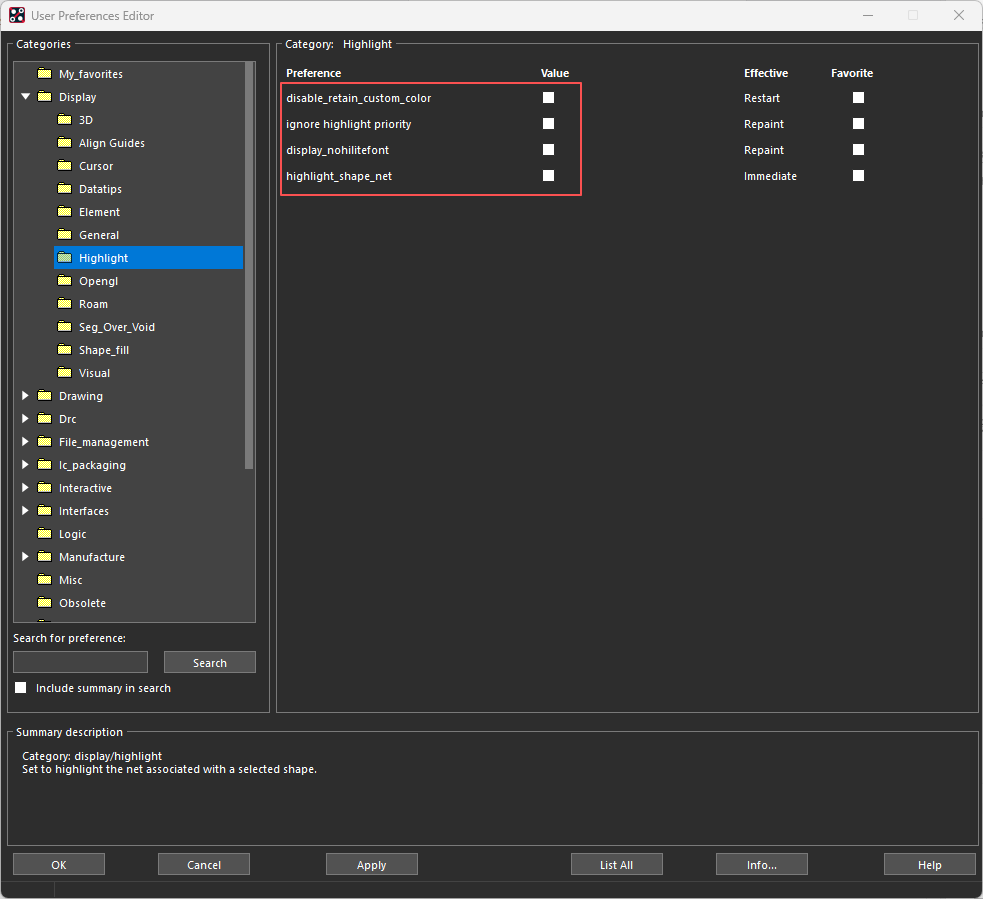
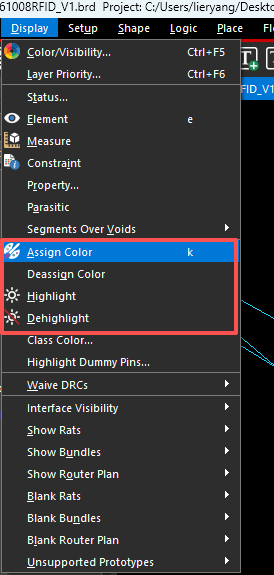
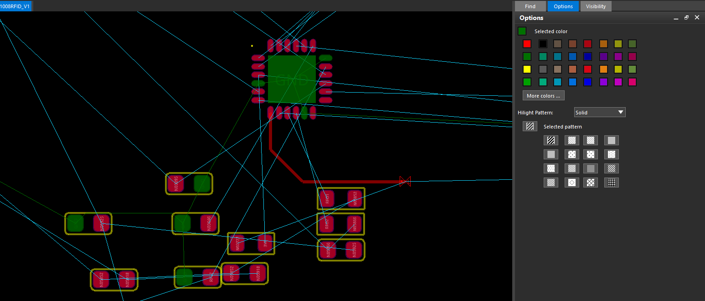
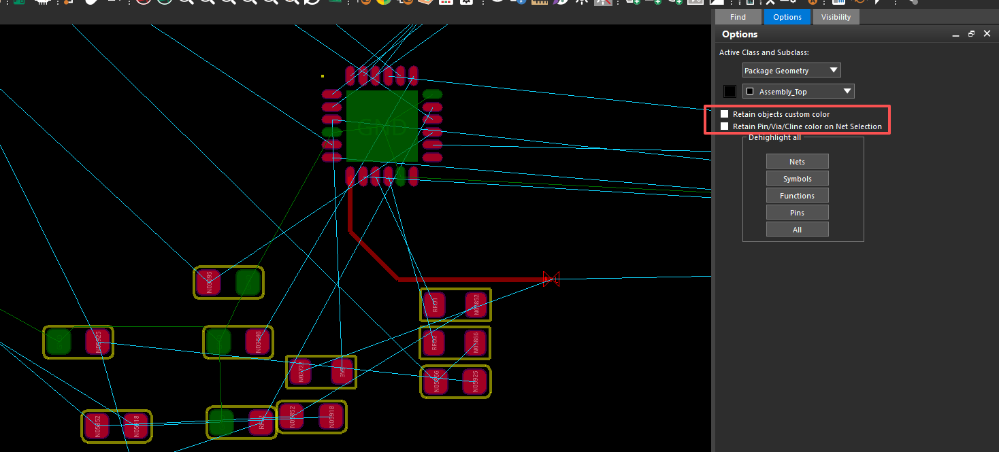

## 1 高亮显示设置

进入 **Setup → User Preferences → Display → Highlight**，设置高亮的显示方式。

| 选项 | 勾选后的作用 |
| --- | --- |
| `disable_retain_custom_color` | 将取消高亮时的“保留对象自定义颜色”默认设为关闭 |
| `ignore_highlight_priority` | 忽略高亮及自定义颜色的显示优先级，按图层优先级显示 |
| `display_nohilitefont` | 使用实色高亮，不显示原色与高亮色交替的条纹／棋盘格效果 |
| `highlight_shape_net` | 选择铜皮进行高亮时，同时高亮它关联的网络 |

修改后点击 `Apply / OK`，按 `Effective` 列的提示刷新显示或重新启动软件。

## 2 颜色与高亮命令

这些命令位于 **Display** 菜单中，可按需要给对象分配颜色或突出显示。

- **Assign Color**：给对象指定自定义颜色，例如将 GND 设为绿色；也可以叠加高亮图案。
- **Highlight**：给对象添加高亮状态，便于查找和追踪网络，不重新指定它的自定义颜色。
- **Dehighlight**：取消高亮，可选择是否同时清除自定义颜色。
- **Deassign Color**：清除已分配的自定义颜色，恢复按图层颜色显示。

**Assign Color 用来区分颜色，Highlight 用来突出当前关注的对象，两者可以叠加。**

## 3 分配颜色与图案

选择 **Display → Assign Color**，在右侧 **Options** 中选择颜色；需要图案时再设置 `Hilight Pattern`。在 **Find** 中选择对象类型，再点击或框选目标对象。给整条网络上色时选 `Nets`，只处理单个焊盘时选 `Pins`。

图中选择了绿色，相关焊盘与网络对象按所选颜色显示。`More colors…` 可打开更多颜色，`Solid` 表示实心显示，也可以选择条纹或棋盘格图案。完成后右键 `Done`。

## 4 取消高亮与恢复颜色

选择 **Display → Dehighlight**，在 **Options** 中先确认是否保留自定义颜色，再点击目标对象；也可以用 `Dehighlight all` 下的 `Nets`、`Symbols`、`Pins` 或 `All` 批量处理。

- 勾选 **Retain objects custom color**：只取消高亮，保留 Assign Color 指定的颜色。
- 不勾选：同时清除高亮和自定义颜色，恢复按图层颜色显示。
- **Retain Pin/Via/Cline color on Net Selection**：在按网络处理时，保留引脚、过孔、走线单独指定的颜色。

图中两个保留选项均未勾选。若希望取消高亮后仍保留绿色等颜色，应先勾选 `Retain objects custom color`。
