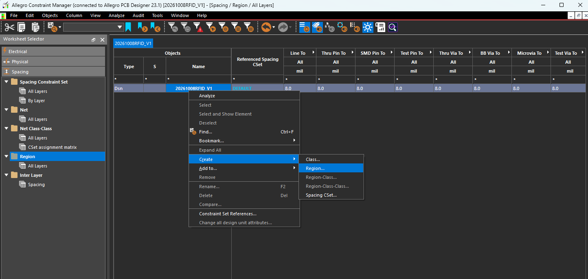
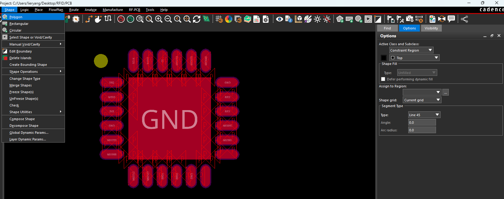
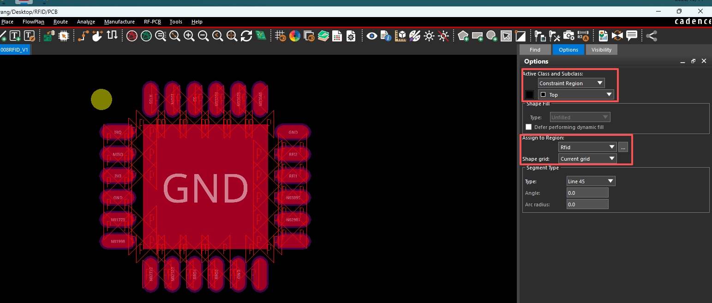

## 1 什么时候使用区域规则

区域规则（Region）用于让 PCB 的某一块区域使用单独的走线、间距规则。例如，QFN、BGA 引脚密集，扇出时需要局部缩小线宽或间距；其他区域仍使用常规规则。局部电路需要更大间距时，也可以建立区域规则。

如果是**整条网络**都需要特殊规则，应给 Net 或 Class 分配规则；如果只是**经过某个区域的部分走线**需要特殊规则，则使用 Region。区域内的尺寸仍需满足板厂加工能力。

| 规则类型 | 主要用途 |
| --- | --- |
| Physical（物理规则） | 设置线宽、缩颈、可用过孔等 |
| Spacing（间距规则） | 设置线与线、线与焊盘、过孔等对象之间的间距 |

## 2 创建区域并指定规则

先在对应的 **Physical Constraint Set / Spacing Constraint Set → All Layers** 中创建需要的 CSet，并填写区域内使用的参数。

图中进入 **Spacing → Region → All Layers**，右击设计名称，选择 **Create → Region…**，输入区域名称，例如 `Rfid`。然后在该区域的 **Referenced Spacing CSet** 列中，选择准备好的间距规则。

如果还需要改变区域内的线宽，再进入 **Physical → Region → All Layers**，为同一个 `Rfid` 区域指定 **Referenced Physical CSet**。只设置 Spacing 不会同时改变线宽。

## 3 绘制区域边界

回到 PCB 编辑窗口，选择 **Shape → Polygon**；矩形区域也可以使用 **Shape → Rectangular**。

在右侧 Options 中，将 Class 设置为 **Constraint Region**，Subclass 选择需要生效的层。图中选择的是 **Top**，因此绘制的是顶层规则区域；它不是铺铜。

在 **Assign to Region** 中选择刚创建的 `Rfid`，然后围住需要特殊规则的器件引脚及扇出范围，绘制闭合边界，按右键菜单提示结束绘制并选择 **Done** 退出。

这里的 `Rfid` 是**区域名称**，具体线宽和间距由它引用的 CSet 决定。Constraint Manager 中的 **All Layers** 是工作表名称，不代表图中选择 Top 绘制的边界会自动作用于所有层。

