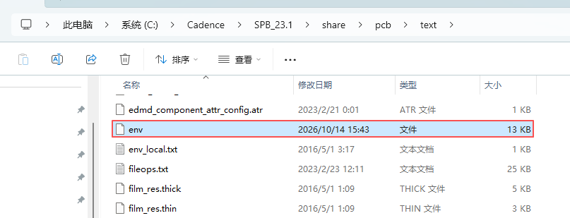

## 1 funckey 和 alias 的区别

`alias` 和 `funckey` 都能把 Allegro 命令绑定到快捷键。主要区别是：**使用字母或数字时，是否需要按 Enter 执行。**

| 对比项 | `alias` | `funckey` |
| --- | --- | --- |
| 主要用途 | 定义命令缩写，也可以绑定功能键 | 定义在绘图区直接触发的快捷键 |
| 字母／数字 | 输入缩写后按 `Enter` 执行 | 焦点在绘图区时，按下对应键即可执行 |
| F1、F2、F3 等功能键 | 按键即可执行，无需 `Enter` | 对这些功能键，触发效果基本相同 |
| 多字母缩写 | 适合输入完整缩写后确认执行 | 支持最多 4 个字母／数字；输入匹配后直接触发 |
| 焦点在命令输入框时 | 作为命令输入，按 `Enter` 执行 | 也按命令输入方式处理，不按绘图区直接触发 |

例如，以下是两种不同的绑定方式，选择一种即可，不要同时给 `z` 重复定义：

```text
alias z "zoom fit"
```

输入 `z` 后按 `Enter`，缩放以完整显示当前设计。

```text
funckey z "zoom fit"
```

焦点在绘图区时，直接按 `Z` 就执行，无需 `Enter`。

### 1.1 什么时候使用 funckey

希望在绘图区直接按字母或数字执行常用操作时，使用 `funckey`，例如缩放、显示设置，或在命令中调整支持的选项。

```text
funckey z "zoom fit"
funckey r "iangle 90"
```

- `z`：在绘图区直接执行缩放。
- `r`：在支持交互旋转的操作中，例如手工放置器件且器件跟随鼠标时，按键旋转 90°；它不是任何状态下都能旋转对象的通用命令。

多字母 `funckey` 要避免前缀冲突。例如同时定义 `a` 和 `ac`，输入第一个 `a` 就可能已经触发，后面的 `ac` 无法正常使用。

### 1.2 什么时候使用 alias

希望输入一个容易记忆的命令缩写，再按 Enter 确认时，使用 `alias`；绑定 `F1～F12` 等功能键时，也可以直接使用 `alias`。

```text
alias ac "add connect"
alias F3 "add connect"
alias F2 done
```

- `ac`：输入 `ac`，按 `Enter`，进入 **Route → Connect** 布线命令。
- `F3`：直接按 `F3` 进入布线，无需 `Enter`。
- `F2`：直接按 `F2` 执行 `done`，结束当前支持该命令的操作。

因此，**`alias` 并不是都要按 Enter，`funckey` 也不只用于 F1、F2 这类功能键。** 字母快捷键需要直接触发时选 `funckey`；命令缩写和功能键绑定可以用 `alias`。

是否打断当前布线、能否在命令进行中执行，取决于绑定的具体命令，不能只根据 `funckey` 或 `alias` 判断。

### 1.3 定义位置与保存

可以先在 Allegro 命令窗口输入定义并按 `Enter`，对当前会话生效。要在下次启动时继续使用，需要把定义写入个人环境目录 `pcbenv` 下的 `env` 文件，再重新启动 Allegro。



## 2 快捷键

