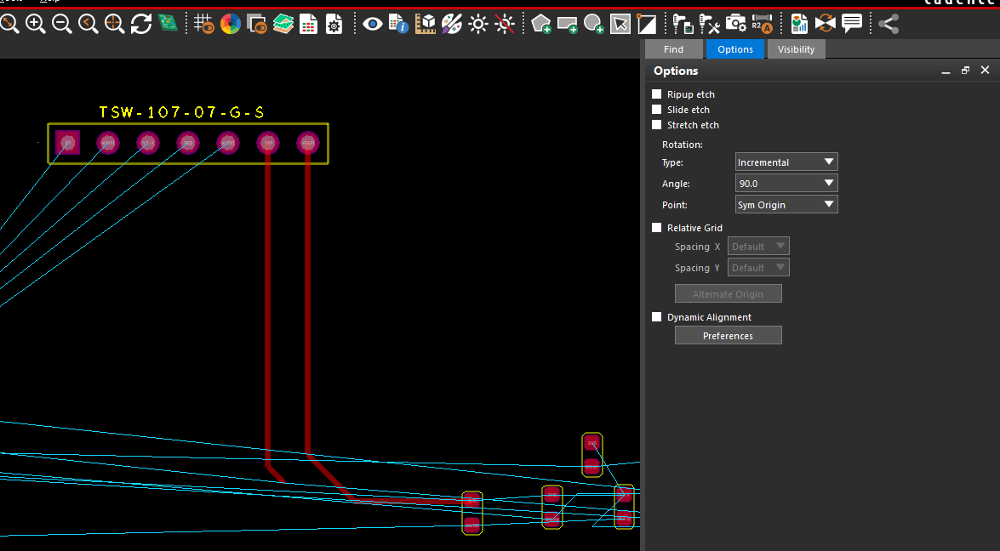
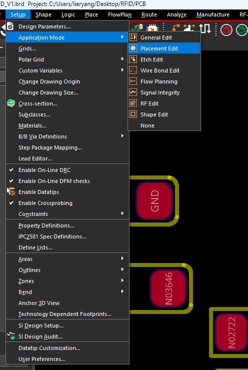
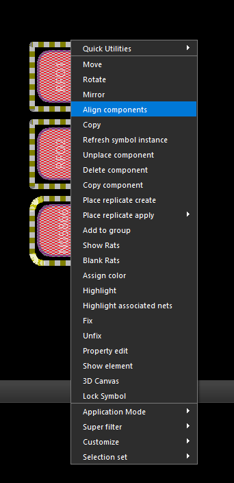
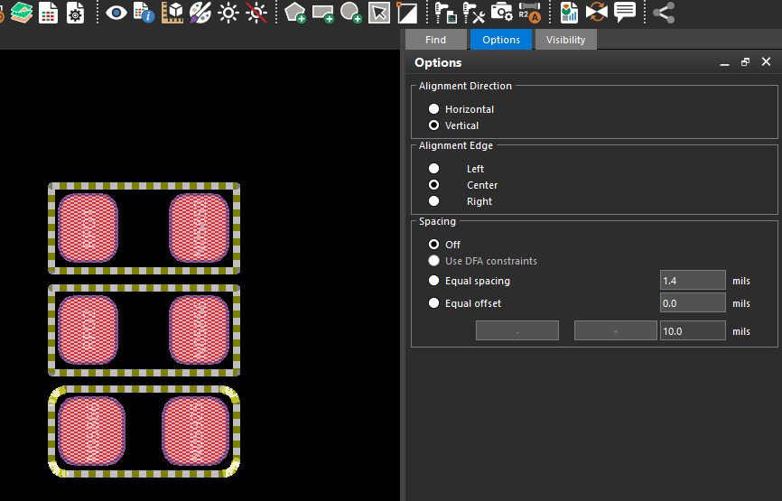

## 1 移动

选择 **Edit → Move**，或按当前配置的 **Q**，在 `Find` 中选择 `Symbols`，点击器件使其跟随鼠标，再点击目标位置放下。器件跟随鼠标时，按空格可按当前快捷键设置旋转 90°。

| Options 选项 | 简要说明 |
| --- | --- |
| `Ripup etch` | 拆除相连的局部布线，通常到最近的引脚、T 接点或过孔，之后重新连接 |
| `Slide etch` | 移动器件时同步调整相连走线，尽量保持正常的 45°／90°走线 |
| `Stretch etch` | 拉伸相连线段，可能产生任意角度斜线 |
| 以上三项均不选 | 仅移动器件，原走线留在原处，可能与焊盘断开 |
| `Rotation → Type` | `Incremental` 为增量旋转；`Absolute` 为转到指定绝对角度 |
| `Angle` | 旋转角度，图中为 90° |
| `Point` | 旋转中心：`Sym Origin` 封装原点、`Body Center` 本体中心、`User Pick` 自选位置、`Sym Pin#` 指定引脚 |
| `Relative Grid` | 以选中对象原点建立临时相对网格，方便按固定距离移动 |
| `Spacing X / Y` | 相对网格的水平／垂直步长；`Default` 使用设计网格值 |
| `Alternate Origin` | 另选相对网格原点 |
| `Dynamic Alignment` | 移动时显示对齐参考线，辅助与其他器件对齐 |
| `Preferences` | 配置动态对齐，例如按器件原点或 Place Bound 边界对齐 |

图中前三项均未勾选，已有走线不会随器件自动调整。已布线器件的小幅移动可尝试 `Slide etch`，完成后检查连接和 DRC。

## 2 对齐与间距调整

先选择 **Setup → Application Mode → Placement Edit**，进入器件布局编辑模式。

选中至少两个同面、未固定的器件，将鼠标停在其中一个基准器件上，右键选择 **Align components**。如果只出现通用菜单，检查当前模式，以及 `Find` 中是否选择了器件而非单个焊盘。

**以哪个器件为基准，由执行右键命令时鼠标停在哪个已选器件上决定。** 例如要让 C1、C3 对齐到 C2 的中心，先选中 C1、C2、C3，再把鼠标停在 C2 的本体或外框上，右键执行 `Align components`。

在右侧 `Options` 中设置对齐方向、对齐边和间距。

| 选项 | 简要说明 |
| --- | --- |
| `Horizontal / Vertical` | 横向排成一行／纵向排成一列 |
| `Alignment Edge` | 选择边缘或中心对齐；横向可选上、下、中心，纵向可选左、右、中心 |
| `Spacing → Off` | 只对齐，不统一调整器件间距 |
| `Use DFA constraints` | 按 DFA 装配间距约束排列 |
| `Equal spacing` | 按输入值设置相等间距，注意右侧单位为 mil |
| `Equal offset` | 按设定偏移量调整位置，23.1 起支持此模式 |
| `− / +` 与步长框 | 按指定步长减小／增大当前间距或偏移量 |

中心对齐时，`Alignment Edge` 选择 **Center**：

- **Horizontal + Center**：中心排成一行，Y 坐标相同。
- **Vertical + Center**：中心排成一列，X 坐标相同。

只做中心对齐时，`Spacing` 选 **Off**，不统一调整排列方向上的间距。这里的中心按器件 **Place Bound 边界中心**计算，可能与封装原点不同。

`Move` 中的动态对齐适合边移动边参考，`Align components` 适合一次整理多个器件。[Cadence 偏移对齐说明](https://community.cadence.com/cadence_technology_forums/pcb-design/f/allegro-x-apd/58463/aligning-components-using-offset-mode-in-allegro-x-apd)
