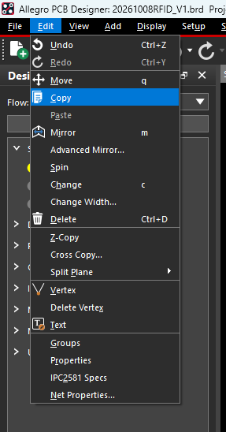
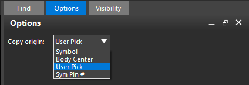
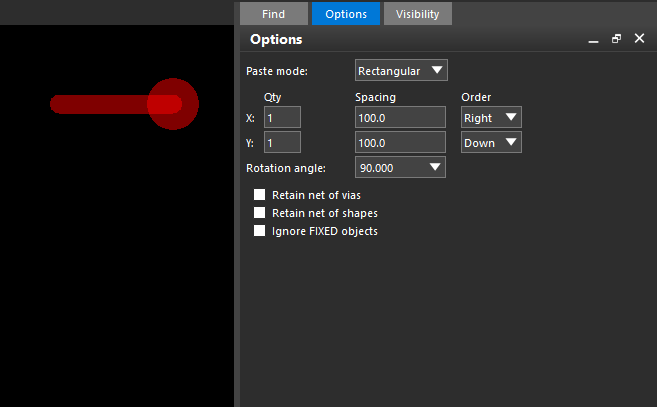
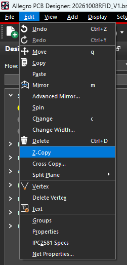
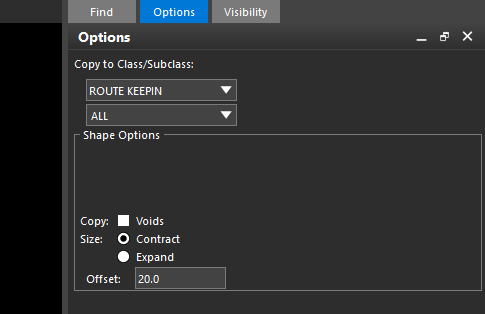
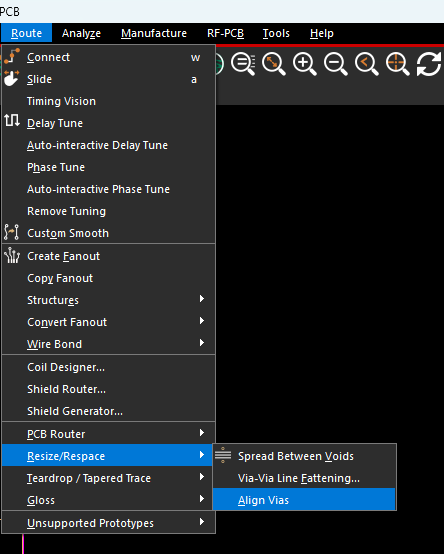
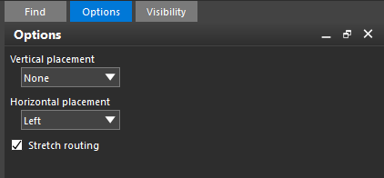

| 命令 | 什么时候使用 | 典型例子 |
| --- | --- | --- |
| **Copy** | 将对象复制到其他位置，需要指定抓取点、放置位置或阵列排列时 | 复制文字；将“走线＋过孔”复制到另一个 Pin |
| **Z-Copy** | 保持原来的 XY 位置，将图形复制到其他 Class / Subclass，或需要内缩、外扩轮廓时 | 根据板框内缩生成 Route Keepin；将铜皮轮廓复制到其他铜层 |

## Copy：复制到其他位置

选择 **Edit → Copy**，在 Find 中启用需要的对象类型，例如 **Clines / Cline Segs、Vias**，然后选择走线和过孔。选好对象及基准点后进入粘贴阶段。

**Copy origin** 决定复制时的抓取基准点，也是旋转中心。

| 选项 | 含义 |
| --- | --- |
| Symbol | 使用元件封装自身的原点 |
| Body Center | 使用元件外形边界的中心 |
| User Pick | 自己指定基准点，适合走线、过孔组合 |
| Sym Pin # | 使用指定编号的元件引脚作为基准点 |

复制“引出线＋过孔”到其他 Pin 时，建议选 **User Pick**。提示选择基准点后，在原 Pin 附近右键 **Snap pick to → Pin**；粘贴时在目标 Pin 附近再次使用该捕捉，保证两端准确对位。

| 粘贴选项 | 作用 |
| --- | --- |
| Paste mode | Rectangular 为矩形阵列，Polar 为极坐标阵列 |
| Qty、Spacing、Order | 设置复制数量、阵列间距及排列方向；图中 X、Y 数量均为 1，只粘贴一份 |
| Rotation angle | 执行旋转时使用的角度，不会仅因填写数值而自动旋转 |
| Retain net of vias | 勾选保留过孔原网络；取消后允许继承目标连接对象的网络 |
| Retain net of shapes | 控制复制的 Shape 是否保留原网络 |
| Ignore FIXED objects | 跳过带 FIXED 属性的对象 |

图中 **Retain net of vias 未勾选**，适合复制到不同网络的 Pin。放置后用 Show Element 检查走线和过孔的网络，再右键 **Done** 退出。

若出现微小偏移，检查 **Snap Offset 是否为 (0,0)**，并确认起点、终点都使用了 Pin 捕捉。Pin 中心可能不在当前栅格上，直接点击可能吸到附近格点；需要自由取点时使用 **Snap pick to → Off-grid Location**。

## Z-Copy：跨 Class / Subclass 复制图形

选择 **Edit → Z-Copy**。它保持图形原来的 XY 位置，可以复制到其他 Class / Subclass，并对轮廓内缩或外扩，常用于由板框生成 Keepin 边界。

图中以生成允许布线区域为例：

1. **Copy to Class/Subclass** 选择 **ROUTE KEEPIN / ALL**。
2. **Size** 选择 **Contract**，设置 **Offset = 20**；当前单位为 mil 时，表示边界向内缩进 20 mil。Expand 则为向外扩展。
3. 点击原板框，生成新边界，右键 **Done** 退出。**Voids** 用于决定是否复制原图形中的挖空。

**Route Keepin 是允许布线区域，Route Keepout 是禁止布线区域；Package Keepin 则是允许放置元件的区域。** 内缩距离按实际板边加工要求设置。

## Via Align：过孔对齐

选择 **Route → Resize/Respace → Align Vias**，也可以在 Command 栏输入 `via align`。

图中的设置用于将过孔向最左侧对齐：

| 选项 | 图中设置及效果 |
| --- | --- |
| Vertical placement | None：保持各过孔的 Y 坐标 |
| Horizontal placement | Left：将所选过孔中心的 X 坐标统一为最左侧过孔的 X |
| Stretch routing | 勾选：移动过孔时拉伸相连走线，保持连接 |

先设置选项，再在 Find 中启用 **Vias**，一次框选至少两个中心位置不同的过孔，完成后右键 **Done**。提示 `At least two non-coincident vias must be selected` 时，表示有效选择数量不足，或选中的过孔中心重合。

对齐依据是**过孔中心坐标**，不是焊盘外边缘。相连走线可随过孔拉伸，独立走线通常使用 **Slide** 调整；完成后检查走线形状及 DRC。
