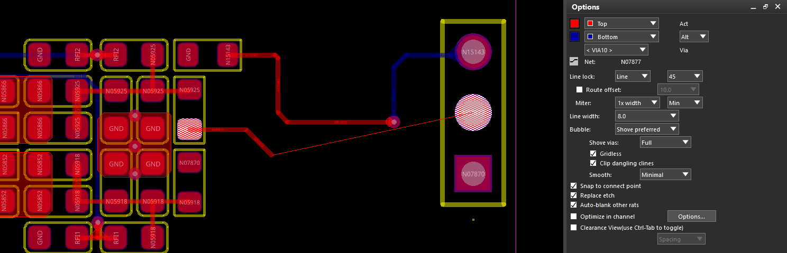

## 1 添加走线

执行 **Route → Connect**（命令：`add connect`），在 **Options** 面板设置布线参数。单击起点焊盘，移动鼠标规划走线；单击确定拐点，连接目标焊盘后完成当前连接，右键 **Done** 退出。

图中正在布线的网络是 **N07877**。红色实线为顶层走线，蓝色实线为底层走线，细线用于提示当前尚未完成的连接。下面的尺寸按设计单位为 **mil** 说明。

### 1.1 图层、过孔与网络

| 选项 | 含义与用法 |
| --- | --- |
| **Act：Top** | 当前布线层，图中为顶层。 |
| **Alt：Bottom** | 备用布线层，图中为底层。添加换层过孔后可切换到该层继续布线。 |
| **Alt / WL 下拉框** | **Alt** 使用一个预设备用层；**WL（Working Layers）** 设置多个可用工作层，布线时通过弹出的层选择窗口选取目标层。 |
| **Via：VIA10** | 换层时使用的过孔焊盘。名称本身不决定尺寸，实际尺寸以对应 padstack 为准。 |
| **Net：N07877** | 当前正在布线的网络。 |

双层板或固定在两个层之间切换时，使用 **Alt**；多层板经常切换不同层时，可使用 **WL**。Alt 模式下，布线过程中右键 **Add Via** 可添加换层过孔；WL 模式下，双击可弹出工作层选择窗口。可选过孔受约束规则和跨层范围限制。

### 1.2 转角与线宽

| 选项 | 含义与用法 |
| --- | --- |
| **Line lock：Line / 45** | 使用直线和 45°折角布线，适合日常布线。角度选 **Off** 时允许任意角度。 |
| **Line lock：Arc** | 使用圆弧转角；切换后，下面的 Miter 会变成 **Radius（半径）**。 |
| **Route offset** | 使走线方向相对常规 45°增量方向偏移，用于特殊角度布线。数值是**角度**，不是线间距；在 **Line / 45** 模式下使用。 |
| **Miter：1x width** | 设置 45°折角的切角尺寸，图中为 1 倍线宽。它表示切去角点的水平或垂直距离，**不是斜线段的长度**。 |
| **Min / Fixed** | **Min** 将 Miter 或 Radius 作为最小值，允许实际值更大；**Fixed** 使用固定值。 |
| **Line width：8.0** | 走线宽度为 **8 mil**。修改数值后仍需满足当前网络的线宽规则。 |

例如图中线宽为 8 mil，Miter 为 `1x width` 且选择 Min，最小切角尺寸就是 8 mil，对应的最小 45°斜线段长度约为 **11.3 mil**。若改为 Arc 模式，Radius 为 `1x width` 且选择 Min 时，最小圆弧半径为 8 mil。

### 1.3 遇到障碍时的避让方式

**Bubble** 控制新走线遇到已有铜对象时如何处理。

| 模式 | 行为 |
| --- | --- |
| **Off** | 不自动避让或推挤，违反间距时会产生 DRC。 |
| **Hug only** | 绕开障碍，保持已有走线的位置。 |
| **Hug preferred** | 优先绕开障碍，绕不开时尝试推挤已有走线。 |
| **Shove preferred** | 优先推开已有走线，无法推开时尝试绕行。图中采用此模式。 |

| 配套选项 | 含义 |
| --- | --- |
| **Shove vias** | **Off** 不推孔；**Minimal** 必要时才推孔；**Full** 更积极地推孔。图中为 Full，布线时可能改变已有过孔的位置。 |
| **Gridless** | 勾选后允许脱离布线栅格，以便按规则间距通过狭窄通道；仍受设计规则约束。 |
| **Clip dangling clines** | 在推挤模式下，允许缩短已有的悬空走线末端，为当前走线让出空间。 |
| **Smooth** | 动态平滑走线。**Minimal** 进行基本整理，**Full** 更充分地减少多余小折线，**Off** 关闭平滑。 |

### 1.4 自动连接、显示与通道优化

| 选项 | 作用及使用场景 |
| --- | --- |
| **Snap to connect point** | 靠近目标焊盘、过孔或连接点时自动捕捉，日常布线可保持勾选。 |
| **Replace etch** | 用新路径替换旧路径。从已有走线分出新路径，再接回原走线时，自动删除被替换的旧段，适合局部重新走线。 |
| **Auto-blank other rats** | 开始实际布线后，临时隐藏其他网络的飞线。适合飞线较多、需要专注当前网络时使用；不会隐藏已有铜线。 |
| **Optimize in channel** | 自动优化两个焊盘或过孔之间通道内的新旧走线，使分布居中。适合通道内走线偏向一侧时使用，可能调整已有走线位置。 |
| **Options…** | 设置通道优化的处理条件，例如通道宽度；不用于修改全板间距规则。 |
| **Clearance View** | 显示间距边界，辅助判断狭窄通道能否通过。按 **Ctrl + Tab** 开关，只影响显示。 |
| **Spacing / Channel** | Clearance View 的显示模式。**Spacing** 按规则间距显示边界；**Channel** 还计入当前走线宽度，更便于判断能否通过。 |

使用时可按需要选择：

- **飞线太乱：** 开启 Auto-blank other rats。若布线中途勾选后未生效，先右键 Done，再重新执行 Connect 并选择起点。
- **走线偏在通道一侧：** 尝试 Optimize in channel；Arc 模式或开启 Route offset 时，该选项不可用。
- **看起来有空隙却走不过去：** 开启 Clearance View，使用 Channel 模式查看通道空间。例如 8 mil 线宽、两侧各要求 8 mil 间距，需要至少 24 mil 的净空。

若希望手动只显示某个网络的飞线，可先退出布线，执行 **Display → Blank Rats → All**，再执行 **Display → Show Rats → Net** 并点击目标网络的焊盘。恢复全部飞线使用 **Display → Show Rats → All**。

## 2 常用修线方法

| 需求 | 命令与操作 |
| --- | --- |
| **平移走线、调整拐角或过孔位置** | 执行 **Route → Slide**，设置 Options，选择线段、拐角或过孔，移动到目标位置后单击确认，右键 Done 退出。 |
| **只移动长线中的一部分** | 在 **Slide** 中右键 **Cut**，在线段上选取两个位置，截取需要调整的部分后移动、确认。 |
| **原路径折点太多，想重新走一段** | 执行 **Connect**，勾选 **Replace etch**，从原走线起点绕出新路径，再接回原走线的另一处，替换旧段。 |
| **清理多余小折线、整理转角** | 执行 **Route → Custom Smooth**，设置转角方式，按 Find 选择所需线段或走线进行优化；已有 DRC 的部分应先处理。 |
| **修改已有走线宽度** | 执行 **Edit → Change**，在 Options 设置 Line width，Find 选择 **Cline Segs** 处理局部线段，或 **Clines** 处理所选连续走线。 |

Slide 中的 **Auto Join** 控制滑动时线段自动合并，按住 **Ctrl** 可临时切换；**Extend Selection** 将所选线段两侧的相邻线段纳入调整，按住 **Shift** 可临时切换，适合保持局部折线形状一起移动。

已有等长或相位调谐的走线，应选择需要处理的局部进行调整，完成后复查长度和 DRC。焊盘入口小斜段、Scribble 模式只显示细线的问题，参见[补充说明](2026-08-31-30-补充.md)。
