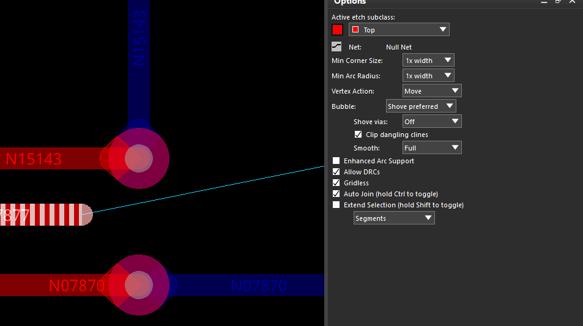

## 1 添加走线

执行 **Route → Connect**（命令：`add connect`），在 **Options** 面板设置布线参数。单击起点焊盘，移动鼠标规划走线；单击确定拐点，连接目标焊盘后完成当前连接，右键 **Done** 退出。

图中正在布线的网络是 **N07877**。红色实线为顶层走线，蓝色实线为底层走线，细线用于提示当前尚未完成的连接。下面的尺寸按设计单位为 **mil** 说明。

### 1.1 图层、过孔与网络

| 选项 | 含义与用法 |
| --- | --- |
| **Act：Top** | 当前布线层，图中为顶层。 |
| **Alt：Bottom** | 备用布线层，图中为底层。添加换层过孔后可切换到该层继续布线。 |
| **Alt / WL 下拉框** | **Alt** 使用一个预设备用层；**WL（Working Layers）** 设置多个可用工作层，布线时通过弹出的层选择窗口选取目标层。 |
| **Via：VIA10** | 换层时使用的过孔焊盘。名称本身不决定尺寸，实际尺寸以对应 padstack 为准。 |
| **Net：N07877** | 当前正在布线的网络。 |

双层板或固定在两个层之间切换时，使用 **Alt**；多层板经常切换不同层时，可使用 **WL**。Alt 模式下，布线过程中右键 **Add Via** 可添加换层过孔；WL 模式下，双击可弹出工作层选择窗口。可选过孔受约束规则和跨层范围限制。

### 1.2 转角与线宽

| 选项 | 含义与用法 |
| --- | --- |
| **Line lock：Line / 45** | 使用直线和 45°折角布线，适合日常布线。角度选 **Off** 时允许任意角度。 |
| **Line lock：Arc** | 使用圆弧转角；切换后，下面的 Miter 会变成 **Radius（半径）**。 |
| **Route offset** | 使走线方向相对常规 45°增量方向偏移，用于特殊角度布线。数值是**角度**，不是线间距；在 **Line / 45** 模式下使用。 |
| **Miter：1x width** | 设置 45°折角的切角尺寸，图中为 1 倍线宽。它表示切去角点的水平或垂直距离，**不是斜线段的长度**。 |
| **Min / Fixed** | **Min** 将 Miter 或 Radius 作为最小值，允许实际值更大；**Fixed** 使用固定值。 |
| **Line width：8.0** | 走线宽度为 **8 mil**。修改数值后仍需满足当前网络的线宽规则。 |

**Miter 可以理解为把直角切成 45°斜角时，沿水平、垂直方向各退让的距离。** `1x width` 表示切角尺寸取当前线宽的 1 倍，并随线宽变化；例如线宽从 8 mil 改成 10 mil，设定的切角尺寸也从 8 mil 变为 10 mil。

以图中的 **8 mil 线宽**为例：

| 设置组合 | 效果 |
| --- | --- |
| **1x width + Min** | 切角尺寸至少为 **8 mil**，实际可以随布线路径增大。 |
| **1x width + Fixed** | 切角尺寸固定为 **8 mil**。这里的固定值仍按当前线宽的倍数计算。 |

当切角尺寸为 8 mil 时，对应的 45°斜线段长度为 **8 × √2 ≈ 11.3 mil**。因此，Min 模式下斜段至少约为 11.3 mil；Fixed 模式下斜段约为 11.3 mil。

日常布线可先用 **1x width + Min**；需要折角尺寸一致时，可使用 **Fixed**。若希望切角尺寸不随线宽变化，可直接填写具体数值。

若改为 Arc 模式，Radius 为 `1x width` 且选择 Min 时，最小圆弧半径为 8 mil。

### 1.3 遇到障碍时的避让方式

**Bubble** 控制新走线遇到已有铜对象时如何处理。

| 模式 | 行为 |
| --- | --- |
| **Off** | 不自动避让或推挤，违反间距时会产生 DRC。 |
| **Hug only** | 绕开障碍，保持已有走线的位置。 |
| **Hug preferred** | 优先绕开障碍，绕不开时尝试推挤已有走线。 |
| **Shove preferred** | 优先推开已有走线，无法推开时尝试绕行。图中采用此模式。 |

| 配套选项 | 含义 |
| --- | --- |
| **Shove vias** | **Off** 不推孔；**Minimal** 必要时才推孔；**Full** 更积极地推孔。图中为 Full，布线时可能改变已有过孔的位置。 |
| **Gridless** | 勾选后允许脱离布线栅格，以便按规则间距通过狭窄通道；仍受设计规则约束。 |
| **Clip dangling clines** | 在推挤模式下，允许缩短已有的悬空走线末端，为当前走线让出空间。 |
| **Smooth** | 动态平滑走线。**Minimal** 进行基本整理，**Full** 更充分地减少多余小折线，**Off** 关闭平滑。 |

### 1.4 自动连接、显示与通道优化

| 选项 | 作用及使用场景 |
| --- | --- |
| **Snap to connect point** | 靠近目标焊盘、过孔或连接点时自动捕捉，日常布线可保持勾选。 |
| **Replace etch** | 用新路径替换旧路径。从已有走线分出新路径，再接回原走线时，自动删除被替换的旧段，适合局部重新走线。 |
| **Auto-blank other rats** | 开始实际布线后，临时隐藏其他网络的飞线。适合飞线较多、需要专注当前网络时使用；不会隐藏已有铜线。 |
| **Optimize in channel** | 自动优化两个焊盘或过孔之间通道内的新旧走线，使分布居中。适合通道内走线偏向一侧时使用，可能调整已有走线位置。 |
| **Options…** | 设置通道优化的处理条件，例如通道宽度；不用于修改全板间距规则。 |
| **Clearance View** | 显示间距边界，辅助判断狭窄通道能否通过。按 **Ctrl + Tab** 开关，只影响显示。 |
| **Spacing / Channel** | Clearance View 的显示模式。**Spacing** 按规则间距显示边界；**Channel** 还计入当前走线宽度，更便于判断能否通过。 |

使用时可按需要选择：

- **飞线太乱：** 开启 Auto-blank other rats。若布线中途勾选后未生效，先右键 Done，再重新执行 Connect 并选择起点。
- **走线偏在通道一侧：** 尝试 Optimize in channel；Arc 模式或开启 Route offset 时，该选项不可用。
- **看起来有空隙却走不过去：** 开启 Clearance View，使用 Channel 模式查看通道空间。例如 8 mil 线宽、两侧各要求 8 mil 间距，需要至少 24 mil 的净空。

若希望手动只显示某个网络的飞线，可先退出布线，执行 **Display → Blank Rats → All**，再执行 **Display → Show Rats → Net** 并点击目标网络的焊盘。恢复全部飞线使用 **Display → Show Rats → All**。

## 2 修线

执行 **Route → Slide**（命令：`slide`），调整已有走线、拐角和过孔的位置，并维持连接关系。

1. 进入 Slide，在 **Find** 中保留需要操作的对象，例如 **Cline Segs** 或 **Vias**。
2. 根据需要设置 **Options**，单击线段、拐点或过孔，移动鼠标进行调整。
3. 到达目标位置后单击确认，可继续选择其他对象修整。
4. 右键 **Done** 结束，检查连接及 DRC。

### 2.1 当前层与最小拐角尺寸

| 选项 | 含义与用法 |
| --- | --- |
| **Active etch subclass：Top** | 当前活动布线层。重叠对象较多时，该层的显示和选择优先级更高；不会将其他层的走线自动换到该层。 |
| **Net：Null Net** | 当前面板未获取到具体网络名称；选择有网络的对象后通常显示对应名称，不能仅凭这里判断走线没有网络。 |
| **Min Corner Size：1x width** | 滑动时允许的最小 45°切角尺寸，图中为当前线宽的 1 倍。其尺寸按水平、垂直退让距离计算，含义与前面的 Miter 类似。 |
| **Min Arc Radius：1x width** | 滑动时允许的最小圆弧半径，图中为当前线宽的 1 倍。 |

以 **8 mil 线宽**为例，`1x width` 对应最小切角尺寸 8 mil，或最小圆弧半径 8 mil。这些参数控制相应拐角的处理，并不保证消除所有短线段。

### 2.2 Vertex Action：点击拐点时如何处理

此设置主要在选择两段走线之间的**拐点**时生效。（比如把拐点转换成圆弧）

| 选项 | 效果与使用场景 |
| --- | --- |
| **Move** | 移动拐点，两侧相连线段随之调整。适合只改变折线位置，图中采用此选项。 |
| **Line Corner** | 在拐点处生成直线切角，并可随鼠标调整大小。适合把直角切成斜角，尺寸受 Min Corner Size 限制。 |
| **Arc Corner** | 将拐点转换成圆弧，并可调整大小。适合将直角、斜角改成圆弧，半径受 Min Arc Radius 限制。 |
| **None** | 不对拐点执行特殊处理，适合专注选择线段进行滑动。 |
| **Edit**（若版本提供） | 按 Edit → Vertex 的方式编辑拐点。 |

### 2.3 避让、推挤与平滑

**Bubble** 决定当前对象移动时，如何处理周围已有铜对象。

| 模式 | 行为 |
| --- | --- |
| **Off** | 不自动避让或推挤，可能产生间距 DRC。 |
| **Hug only** | 绕开障碍，保持其他已有走线的位置。 |
| **Hug preferred** | 优先绕开障碍，无法绕开时尝试推挤。 |
| **Shove preferred** | 优先推开其他已有走线，无法推开时尝试绕行。图中采用此模式。 |

| 配套选项 | 含义与用法 |
| --- | --- |
| **Shove vias** | 控制周围过孔是否允许被自动推开。**Off** 不推孔；**Minimal** 必要时才推孔；**Full** 更积极地推孔。图中为 Off，但仍可直接选择过孔进行 Slide。 |
| **Clip dangling clines** | 推挤时允许缩短过近、妨碍操作的悬空线头，为当前走线让出空间。 |
| **Smooth** | **Minimal** 进行基本平滑；**Full** 更充分地减少多余小折线；**Off** 关闭平滑。仅处理本次滑动、推挤影响的线段及相关邻接段，不会自动整理全板。 |
| **Enhanced Arc Support** | 遇到圆弧或圆形对象时，允许避让算法生成圆弧，并对受影响走线采用圆弧转角。需要圆弧修线时启用，普通直线修整可先不勾选。 |

### 2.4 规则、栅格与联动选择

| 选项 | 含义与使用场景 |
| --- | --- |
| **Allow DRCs** | 勾选后允许本次修线产生规则违规，违规会留下 DRC 标记。取消后，软件可能阻止引入违规的移动；所选走线已有 DRC 时也可能无法滑动。图中已勾选，调整后需复查。 |
| **Gridless** | 允许修线时脱离布线栅格，便于按规则间距调整位置；不代表关闭 DRC。 |
| **Auto Join** | 滑动中相遇且可合并的同网络平行线段自动合并，适合消除折返、连续整理线段。按住 **Ctrl** 可临时反转当前状态。 |
| **Extend Selection** | 将相邻对象纳入本次调整，适合保持局部折线的基本形状一起移动。按住 **Shift** 可临时反转当前状态。 |
| 底部 **Segments** 下拉框 | 配合 Extend Selection，指定扩展选择哪些相邻对象，具体见下表。 |

| 扩展范围 | 含义 |
| --- | --- |
| **Segments** | 纳入相邻走线段，通常为所选线段两侧各一段。 |
| **Vias** | 纳入相邻过孔。 |
| **Segments and Vias** | 同时纳入相邻走线段和过孔。 |

**Ctrl、Shift 都是临时切换当前勾选状态**，并非只有按住按键，相应功能才有效。底部下拉框控制联动范围，选择目标对象仍使用 **Find**。

### 2.5 常用操作与选择方法

| 需要实现的效果 | 操作方法 |
| --- | --- |
| **平移一段走线** | 在 Slide 中单击线段，移动到目标位置，再单击确认。 |
| **保持一组折线形状一起移动** | 选择 Extend Selection 的范围，在操作时按住 **Shift** 临时切换，再移动线段。 |
| **把直角改成斜角或圆弧** | Vertex Action 选 **Line Corner** 或 **Arc Corner**，单击拐点并调整。 |
| **只移动长线中的一部分** | 在 Slide 中右键 **Cut**，在线段上选择两个位置，截取该部分后移动、确认。 |
| **移动过孔并保持连接** | Find 勾选 **Vias**，直接选中过孔进行 Slide，检查各连接层的走线变化。 |
| **原路径折点太多，想重新走一段** | 改用 **Connect**，勾选 **Replace etch**，从原走线分出新路径，再接回原走线的另一处，替换旧段。 |
| **清理多余小折线、整理转角** | 使用 **Route → Custom Smooth**，设置转角方式并选择所需线段或走线；已有 DRC 的部分应先处理。 |

日常可先使用 **Move、Shove preferred、Shove vias Off、Gridless、Auto Join**；Smooth 根据需要选择 Minimal 或 Full，Allow DRCs 通常先取消。已有等长或相位调谐的走线，局部调整后应复查长度和相关约束。

若焊盘入口的小斜段始终无法推入焊盘，可检查 **Enhanced Pad Entry**，操作见[补充说明第 1 节](2026-08-31-30-补充.md#1-焊盘入口有小斜段如何将走线修直)。
