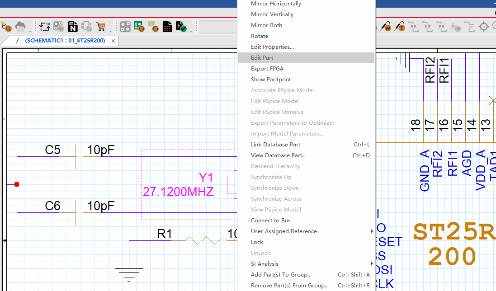
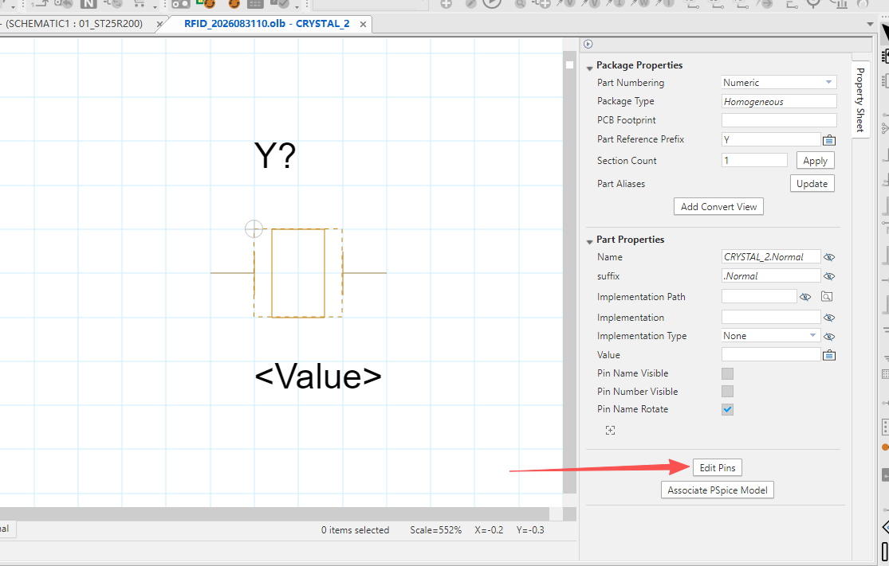
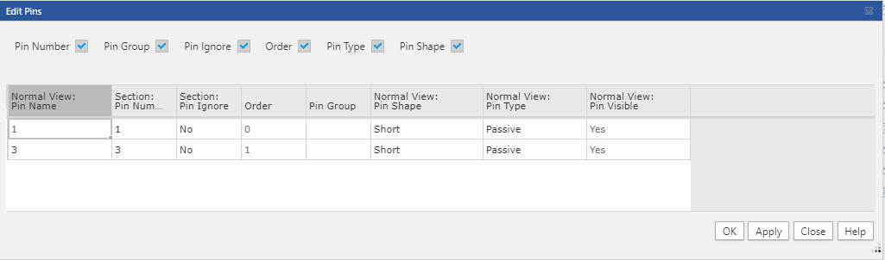
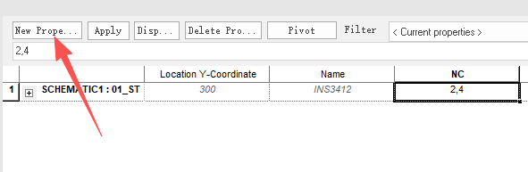
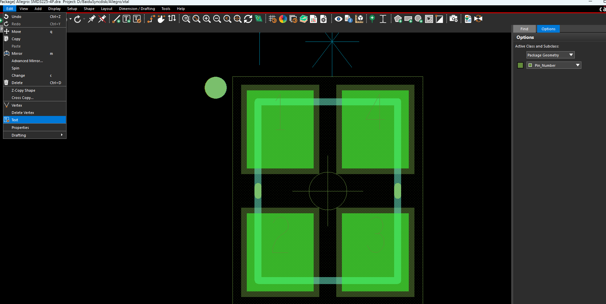

## 1 未放置元件与引脚不匹配

在 **Display → Status** 中，`Unplaced symbols = 1/40` 表示 40 个元件中还有 1 个未放置。点击左侧彩色方块可以查看封装可用性报告；通过 **Place → Manually → Components by refdes** 可以找到剩余位号，本例为 `Y1`。

能显示封装预览，不代表引脚定义已经匹配。放置时出现以下提示，说明 PCB 封装与原理图网表中的引脚编号不一致：

```text
(SPMHGE-82): Pin numbers do not match between symbol and component.
Run dev_check on device file for more information.
```

本例原理图只有两个引脚，原编号为 **1、2**；四焊盘封装的有效引脚为 **1、3**，另外 **2、4** 按器件定义悬空。处理后应为：

| PCB 焊盘编号 | 原理图中的处理 |
| --- | --- |
| 1 | 保持原引脚 1 及其连接 |
| 3 | 将原引脚 2 的编号改为 3，保持原连接 |
| 2、4 | 在 Y1 上添加 `NC = 2,4`，声明未连接引脚 |

引脚编号及用途以具体器件数据手册为准。对于 Capture → Allegro 流程，先核对原理图、网表和封装的编号；提示中的 dev_check 主要用于有 device 文件的流程。

## 2 原理图修改 Pin

在 **Capture 原理图页面**选中 Y1，右键选择 **Edit Part**，进入符号编辑器。



在符号编辑器右侧点击 **Edit Pins**，打开引脚表。也可以双击某个引脚，单独编辑其属性。



将第二个引脚的 **Pin Number** 从 `2` 改为 `3`，第一个仍为 `1`，点击 **Apply / OK**。图中两行编号已为 **1、3**。

| 字段 | 含义 |
| --- | --- |
| Pin Number | 实际引脚编号，用于匹配 PCB 焊盘；本例需要修改这一项 |
| Pin Name | 引脚名称，用于说明功能；只改名称不能改变焊盘映射 |
| Order | 引脚的排列顺序，不是 PCB 焊盘编号 |



### Edit Part 会不会修改原始库

| 编辑方式或保存选项 | 影响范围 |
| --- | --- |
| 从原理图进入 Edit Part，选择 Update Current | 只更新当前编辑的实例，修改保存在当前设计的 Design Cache 中 |
| 从原理图进入 Edit Part，选择 Update All | 更新当前设计中使用同一符号的实例，不直接改写原始 `.olb` |
| 直接打开 `.olb` 库中的符号并保存 | 修改该库文件；已有设计还需要更新缓存后才采用库中的修改 |

只修改 Y1 时，退出符号编辑器后选择 **Update Current**。如果直接修改了库文件，则在当前设计的 **Design Cache** 中更新对应符号，确认 Y1 已采用新的 **1、3** 编号。

### 添加悬空引脚属性 NC

回到原理图，选中 Y1 → 右键 **Edit Properties**。在 Property Editor 中选中 Y1 所在行，点击左上角 **New Property**，填写：

| 项目 | 内容 |
| --- | --- |
| Name | `NC` |
| Value | `2,4`，使用英文逗号分隔 |

点击 **OK → Apply** 并保存。图中的 `NC` 列已经填写 `2,4`，表示保留四焊盘封装，但两个额外编号不参与连接。



这里是给**器件添加 NC 属性**，不是创建名为 NC 的网络。`NC` 列表只填写符号中未画出的悬空引脚；本例已使用的 **1、3** 不应填入。如果原理图已经画出了全部四个引脚，则可对未使用的 **2、4** 放置 No Connect 标记，不再对同一引脚重复使用 NC 属性。

## 3 PCB 封装修改 Pin Number

如果封装编号本身需要修改，打开对应的 **`.dra` 封装文件**，在封装编辑器中操作：

1. 打开 Pins 和 **Package Geometry / Pin_Number** 的可见性。
2. 在 Find 中只勾选 **Text**，选择 **Edit → Text**，点击与焊盘关联的编号进行修改；也可在编号上右键 **Text Edit**。
3. 修改后右键 **Done**，用 Show Element 检查各焊盘实际编号，保存并生成更新后的 **`.psm`**。



封装中与焊盘关联的 **Package Geometry / Pin_Number 文字就是实际引脚编号**，修改它会改变焊盘编号；普通丝印上的数字只是标注。输入已存在的编号时可能发生编号交换，完成后需核对所有焊盘的位置与编号。

本例封装已经正确对应 **1、3 有效，2、4 悬空**，只需调整原理图及 NC 属性；无需再改变封装编号。若实际修改了封装库，已有 PCB 可通过 **Place → Update Symbols** 更新对应封装。

## 4 同步到 PCB 并检查

保存原理图，重新生成 PCB 网表并导入 Allegro，再通过 **Place → Manually** 放置 Y1。检查导入日志是否仍有引脚不匹配错误，并确认 **1、3** 对应原有信号，**2、4** 未连接。

最后在 **Display → Status → Refresh** 中确认未放置数量。若只有 Y1 未放置且本次放置成功，数量应变为 **0/40**。
