## 1 模块复用

适合同一块板或不同设计中，存在**元件、连接关系相同或相似的重复电路**。先完成一组布局布线，再保存为 `.mdd` 模板，应用到目标电路已有的元件上。

**① 切换模式。** 选择 **Setup → Application Mode → Placement Edit**。

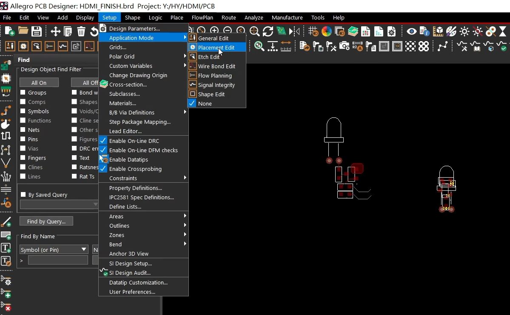

**② 创建模板。** 在 Find 中启用 Symbols，框选已完成布局的源电路元件，鼠标停在选中元件上，右键选择 **Place replicate create**。

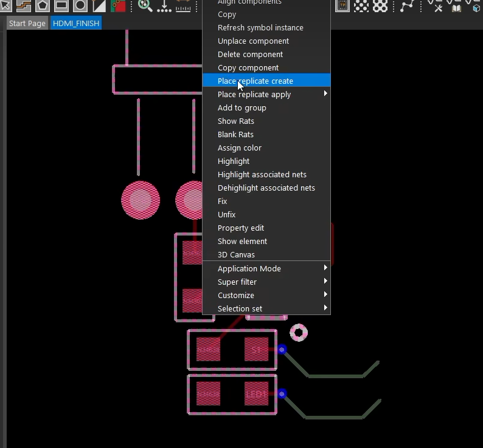

按命令提示补选需要包含的走线、过孔和铜皮，右键 **Done**，指定模块基准点，然后命名并保存 **`.mdd`** 文件。

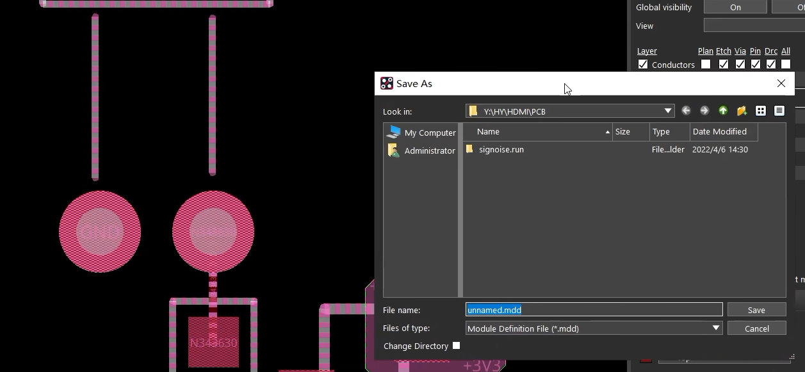

**③ 应用模板。** 框选目标电路的对应元件，右键 **Place replicate apply**，选择已创建的模块，或通过 **Browse…** 加载 `.mdd` 文件。

**④ 检查对应关系。** 若弹出匹配窗口，检查 **Seed circuit → Match**。图中 `Led1 → Unmatched` 表示尚未匹配；点击该项，再从右侧 **Similar components** 选择正确的目标元件。Device name、Value 用于筛选候选元件。

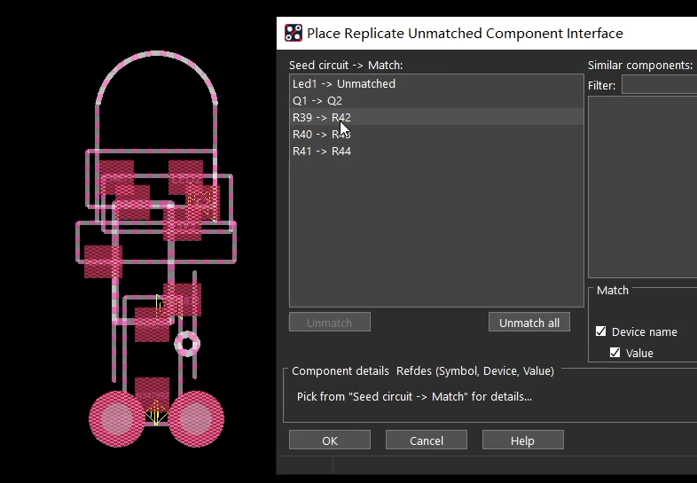

对应关系确认后点击 **OK**，按提示放置模块并结束命令，检查连接及 DRC。此功能复用布局布线，**不会自动新增原理图元件或改变目标元件的网络分配**，目标电路需先导入网表。

## 2 导入导出位置

适合保存、恢复或迁移**元件位置和旋转角度**，不包含走线、过孔和铜皮。

1. 在源设计选择 **File → Export → Placement**，指定文件名，例如 `place_txt.txt`，选择坐标基准并导出。
2. 在目标设计选择 **File → Import → Placement**，加载该文件，**Placement origin 与导出时保持一致**，一般使用 Symbol origin。
3. 只放置尚未放置的元件时选择 **Add unplaced components**；还需要调整已放置元件位置时选择 **Add and move**。
4. 核对固定器件处理选项，点击 **Import**，完成后检查元件位置。目标设计中的位号需与位置文件对应。

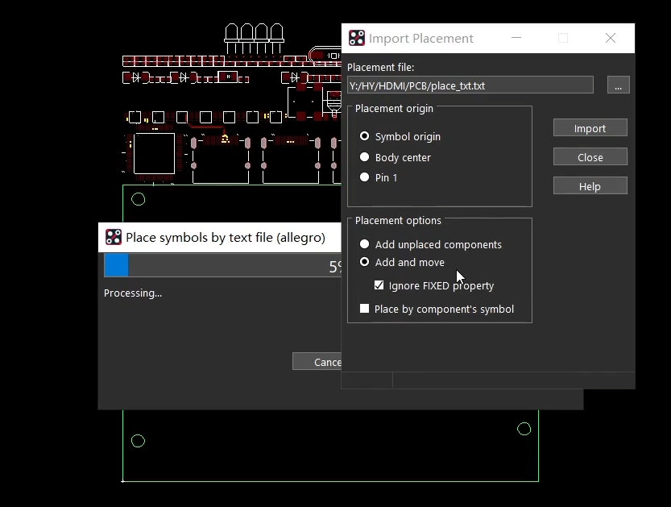

| Placement origin | 坐标对应的位置 |
| --- | --- |
| Symbol origin | 封装自身原点 |
| Body center | 元件外形边界中心 |
| Pin 1 | 元件的 1 号引脚 |

## 3 Sub-Drawing

用于将选中的元件、走线、过孔、铜皮或图形保存成 **`.clp` 子图文件**，再导入当前或其他设计。

**① 开始导出。** 在源设计选择 **File → Export → Sub-Drawing**。

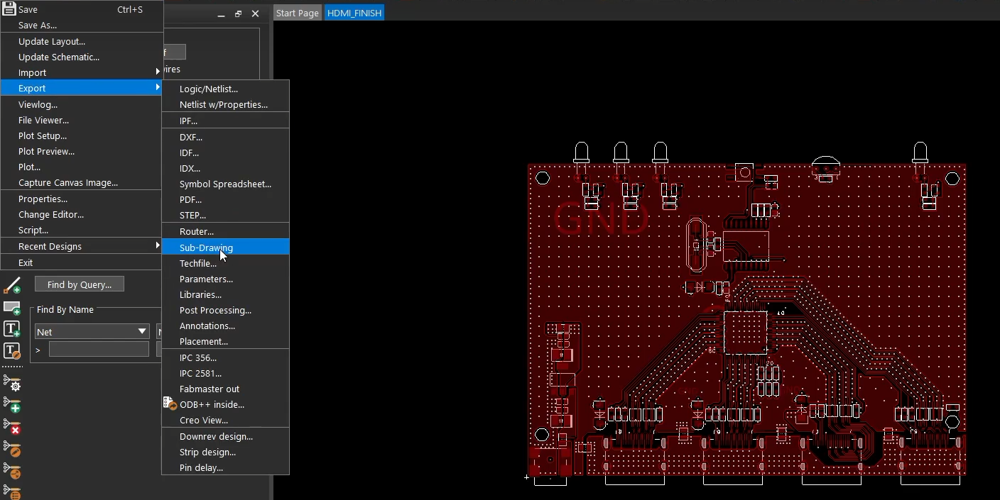

**② 设置保留信息。** 图中勾选了以下选项，按实际复用需求选择：

| 选项 | 作用 |
| --- | --- |
| Create missing non-conductor layers | 允许创建缺失的非导电层 |
| Preserve Refdes | 保存元件位号信息 |
| Preserve nets of shapes | 保存铜皮的网络信息 |
| Preserve nets of vias | 保存过孔的网络信息 |
| Preserve Testpoints on vias | 保存过孔的测试点信息 |

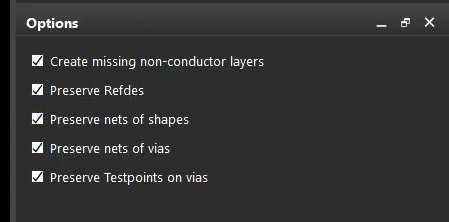

**③ 选择导出对象。** 按图中流程，先在 Find 中启用并选择**过孔和走线**，再启用 Shapes 选择铜皮；需要同时保留元件时，将对应 Symbols 一起选入。确认范围后右键 **Complete**。

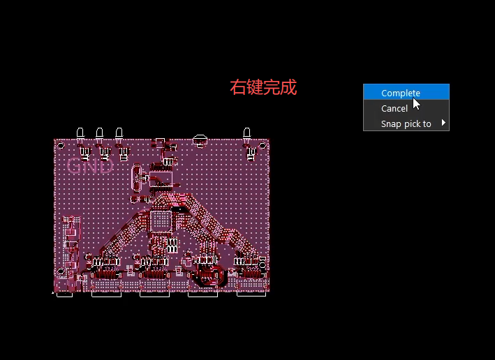

**④ 指定基准点并保存。** 出现 `Pick clipboard origin point` 提示后，指定子图基准点。需要按原坐标复用时，可在 Command 栏输入 `x 0 0`，回车后保存 `.clp` 文件。

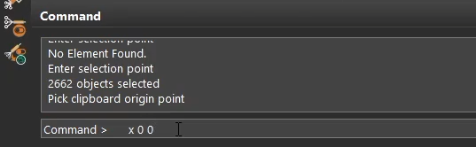

**⑤ 导入子图。** 在目标设计选择 **File → Import → Sub-Drawing**，加载刚保存的 `.clp`，核对位号和网络保留选项。

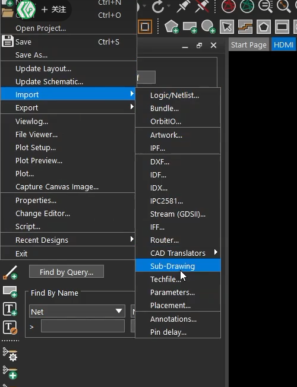

**⑥ 放置并检查。** 子图跟随鼠标后指定位置；若导出基准点为 `(0,0)`，且需要保持原坐标，则再次输入 **`x 0 0`**，回车放置并结束命令。

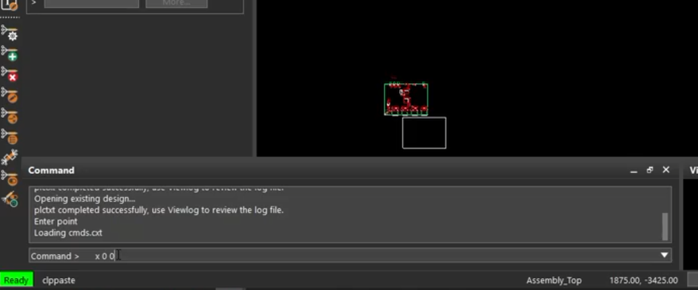

跨设计导入时，需核对目标板的位号、网络和层名；保留网络选项不会自动完成不同电路之间的网络映射。导入后检查连接、铜皮及 DRC。

| 方法 | 主要用途 |
| --- | --- |
| Place replicate（`.mdd`） | 将一组布局布线匹配并应用到另一组对应元件 |
| Placement（位置文件） | 保存或恢复元件坐标、角度 |
| Sub-Drawing（`.clp`） | 将选中的设计对象保存为文件，供跨设计导入复用 |

参考：[Cadence：Place Replicate 模块复用](https://community.cadence.com/cadence_technology_forums/pcb-design/f/allegro-x-scripting-skill/62587/place-module-mdd-file-without-using-hierarchical-blocks/1401211)、[Cadence：Sub-Drawing 导入导出](https://community.cadence.com/cadence_technology_forums/pcb-design/f/pcb-design/7351/copy-paste-of-wiring-from-refernce-design/7353)。
