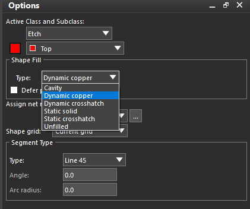
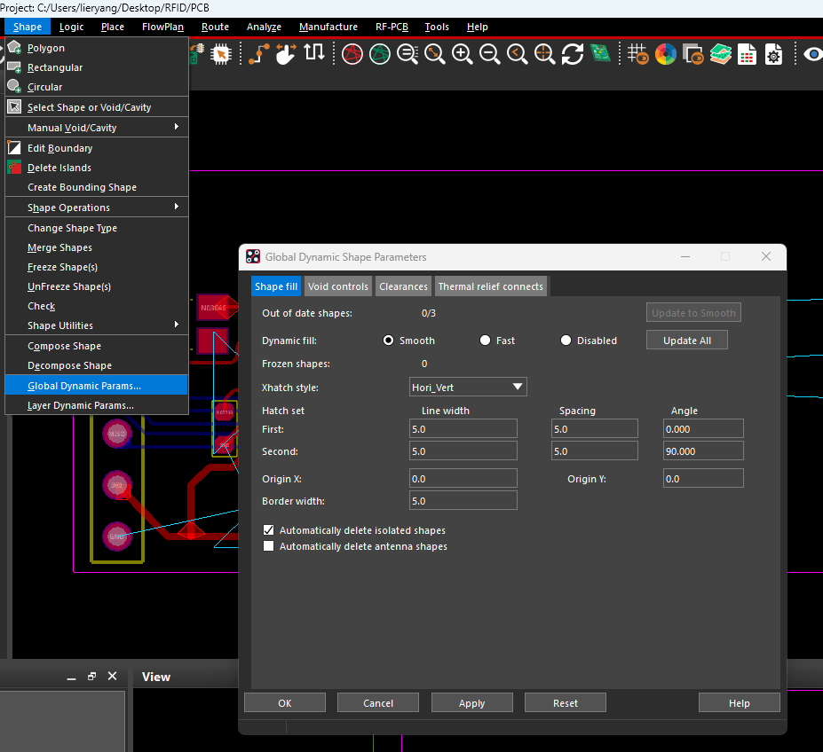
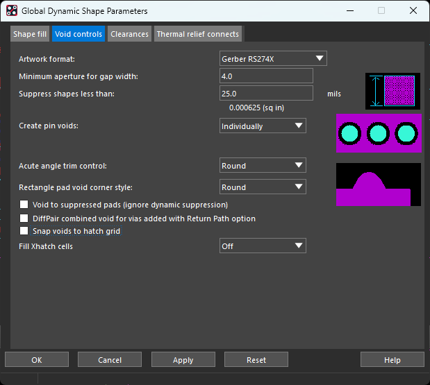
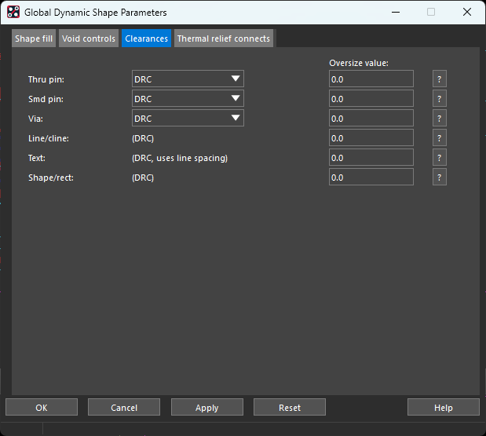
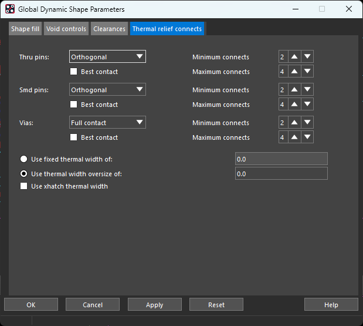

执行 **Shape → Global Dynamic Params** 设置全局动态铜皮参数；只修改某块铜皮时，使用 **Shape → Select Shape or Void/Cavity** 选择铜皮，右键 **Parameters**。局部覆盖的参数以该块铜皮的设置为准。以下尺寸单位为 **mil**。

## 1 Shape fill：填充与更新

### 1.1 新建铜皮：Options 面板

执行 **Shape → Polygon / Rectangular / Circular** 后，在右侧 Options 设置铜皮类型、图层和网络。

**Shape Fill → Type** 决定创建哪种铜皮或形状：

| 类型 | 含义与用途 |
| --- | --- |
| **Dynamic copper** | 动态实心铜，修改走线、过孔或边界后自动避让、回填，普通电源／地铺铜优先使用。 |
| **Dynamic crosshatch** | 动态网格铜，自动更新；按特殊工艺或设计要求使用。 |
| **Static solid** | 静态实心铜，不自动避让，适合需要手动控制轮廓和挖空的铜区。 |
| **Static crosshatch** | 静态网格铜，不自动避让。 |
| **Unfilled** | 只有边界、不填充，可用于板框等非电气图形，不能作为 Etch 层铜皮使用。 |
| **Cavity** | 嵌入式器件周围的介质腔体，用于特殊嵌入式设计。 |

| 其他参数 | 主要作用 |
| --- | --- |
| **Active Class and Subclass** | 指定绘制层，普通顶层铺铜选 **Etch / Top**，底层选 **Etch / Bottom**。 |
| **Defer performing dynamic fill** | 勾选后暂缓当前铜皮填充，便于先编辑边界；需要立即铺铜时不勾选。 |
| **Assign net name** | 指定铜皮所属网络，如 GND。点击右侧 **…** 从网络列表选择。 |
| **Shape grid** | 铜皮边界的绘制栅格；**Current grid** 跟随当前栅格，**None** 允许脱离栅格。 |
| **Segment Type → Type** | 控制铜皮边界的画法：**Line** 任意角度直线、**Line 45** 45°折线、**Line Orthogonal** 正交线、**Arc** 圆弧。 |
| **Angle / Arc radius** | 绘制圆弧边界时设置角度、半径，不是铜皮间距。 |

**常规实心铺地：Etch / 目标层＋Dynamic copper＋GND，取消 Defer，并将全局 Dynamic fill 设为 Smooth。**

### 1.2 全局填充与更新

| 选项 | 主要作用 |
| --- | --- |
| **Dynamic fill** | **Smooth** 完整填充、避让并检查，日常使用；**Fast** 快速预览，输出前需更新为 Smooth；**Disabled** 暂停动态填充，适合大量修改时暂时使用。 |
| **Out of date shapes / Update to Smooth / Update All** | 查看待更新铜皮数量，并将铜皮重新计算、更新。输出制造文件前应完成 Smooth 更新，待更新数量为 0。 |
| **Frozen shapes** | 已冻结、暂停自动更新的铜皮数量；需要修改时先解除冻结。 |
| **Xhatch style** | 网格铜的方向组合，如水平、垂直、斜向或自定义。**这里不是实心／网格铜的切换入口。** |
| **Line width / Spacing / Angle** | 网格线的宽度、中心间距及角度；First、Second 分别设置两组线。 |
| **Origin X/Y / Border width** | 网格起点和铜皮边框宽度。 |
| **Automatically delete isolated shapes** | 自动清理未连接的孤铜，日常铺地可启用。 |
| **Automatically delete antenna shapes** | 自动清理仅连接单个过孔的天线状铜皮，按需启用。 |

**动态实心铺铜：** 新建铜皮时在 Options 选择 **Type：Dynamic Copper**，全局 Dynamic fill 保持 **Smooth**。已有网格铜皮需选中后右键 **Parameters → Shape fill → Fill style：Solid**；全局改成 Smooth 不会将网格铜自动改为实心。

## 2 Void controls：挖空与细碎铜处理

| 选项 | 主要作用 |
| --- | --- |
| **Artwork format** | 预期光绘格式，与制造输出格式保持一致，图中为 Gerber RS274X。 |
| **Minimum aperture for gap width** | 两个避让空区之间的细铜不足此宽度时，合并空区、去掉细铜。图中为 **4 mil**；可按板厂能力和填充效果调整，并非铜皮到走线的间距。 |
| **Suppress shapes less than** | 抑制面积过小的铜块。图中 **25 mil** 对应 **25 × 25＝625 mil²＝0.000625 in²**，判断的是面积，不是铜条宽度。 |
| **Create pin voids** | **Individually** 对每个焊盘分别避让；**In-line** 对符合条件的一排焊盘整体挖空，减少中间碎铜。 |
| **Acute angle trim control** | **Round** 圆滑修整锐角；**Chamfer** 直线倒角；**Full Round** 也处理直角位置。 |
| **Rectangle pad void corner style** | 矩形焊盘周围避让区采用 Round 或 Square，不改变焊盘形状。 |
| **Void to suppressed pads** | 即使焊盘被抑制，仍按焊盘轮廓避让；普通设计可先不选。 |
| **DiffPair combined void…** | 为通过 Return Path 功能创建的差分过孔组生成合并避让区。 |
| **Snap voids to hatch grid** | 使网格铜的避让边界对齐网格，仅用于网格填充。 |
| **Fill Xhatch cells** | 控制网格边界处不完整单元的补铜程度，Off 关闭，Low 到 High 逐步增加；不能与 Snap voids to hatch grid 同时使用。 |

若细铜桥消失，检查 Minimum aperture；若小铜块不填充，检查 Suppress shapes。不要仅靠降低参数保留重要的细颈连接，应同时检查实际导通和载流路径。

## 3 Clearances：铜皮避让间距

| 项目 | 对应对象 |
| --- | --- |
| **Thru pin / Smd pin / Via** | 通孔焊盘、贴片焊盘、过孔铜盘。 |
| **Line/cline** | 线与电气走线。 |
| **Text** | 铜层文字，按对应线间距规则处理。 |
| **Shape/rect** | 其他铜皮或填充矩形。 |

选择 **DRC** 时，按约束管理器中实际生效的 Shape 到相应对象的间距避让：

**目标边缘净间距＝有效 DRC 间距＋Oversize value。**

例如 DRC 为 **8 mil**、Oversize 为 **2 mil**，目标净间距为 **10 mil**。图中 Oversize 全部为 0，表示直接采用规则间距；上一页的 Minimum aperture 不加进此公式。圆角和细铜清理可能使局部实际间距更大。

通常保持 **DRC＋Oversize 0**，在约束管理器中统一管理间距。若改为 **Thermal/Anti**，则参考 padstack 中的热焊盘／隔离盘尺寸，避让仍不得小于适用 DRC 要求。

## 4 Thermal relief connects：同网络连接方式

此页控制铜皮与**同网络**焊盘、过孔如何连接；不同网络仍需避让。

Thru pins、Smd pins、Vias 分别设置通孔焊盘、贴片焊盘和过孔的连接方式。

| 选项 | 效果与用途 |
| --- | --- |
| **Orthogonal** | 水平、垂直方向的热连接，常称十字连接，可减少大面积铜皮对焊接热量的吸收。 |
| **Diagonal** | 沿对角方向生成热连接。 |
| **8-Way** | 同时沿正交、对角方向连接，最多 8 条。 |
| **Full contact** | 全连接，适合需要直接导通、散热或载流的连接；焊盘是否采用需结合焊接要求。 |
| **None**（若提供） | 不自动生成热连接，需要另外保证所需电气连接。 |
| **Best contact** | 必要时旋转连接条方向，尝试满足所需连接数量。 |
| **Minimum / Maximum connects** | 最少／最多热连接条数。图中为 **2／4**；Full contact 时不适用。 |
| **Use fixed thermal width of** | 使用固定连接条宽度。 |
| **Use thermal width oversize of** | 连接条宽度＝该网络物理规则中的最小线宽＋这里的增量；图中增量为 0。 |
| **Use xhatch thermal width** | 使用网格铜线宽生成热连接，仅用于网格铜。 |

图中的设置为：**通孔、贴片焊盘采用十字热连接，过孔采用全连接**。连接条数量不足最低要求时，焊盘可能无法接上铜皮，应检查可用空间、间距和连接条宽度。

## 5 新建铺铜与完成检查

1. 执行 **Shape → Polygon / Rectangular / Circular**，选择铜皮外形。
2. Options 选择 **Etch／目标铜层、Dynamic Copper、目标网络**，如 GND；不勾选 Defer performing dynamic fill，以立即填充。
3. 绘制边界并完成；需要局部挖铜用 **Manual Void/Cavity**，修改轮廓用 **Edit Boundary**。
4. 更新为 **Smooth**，通过 **Display → Status** 检查待更新铜皮、孤铜、未连接网络和 DRC。必要时使用 **Shape → Delete Islands** 清理孤铜。

**有铜填充不等于已经接地。** 确认铜皮网络正确，检查窄铜桥及焊盘连接，并用合适的 GND 过孔连接需要互通的地铜层。
