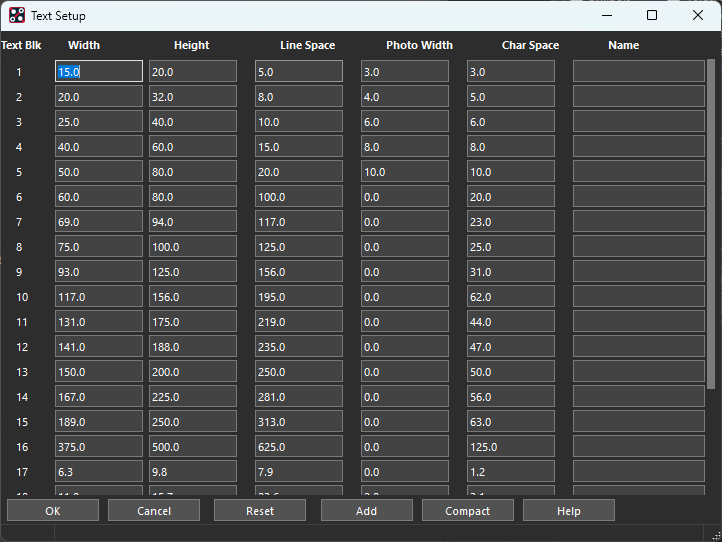
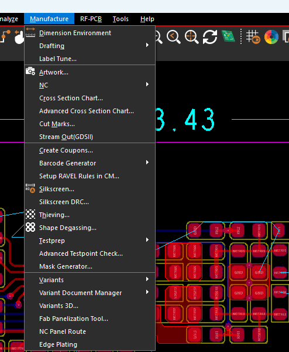
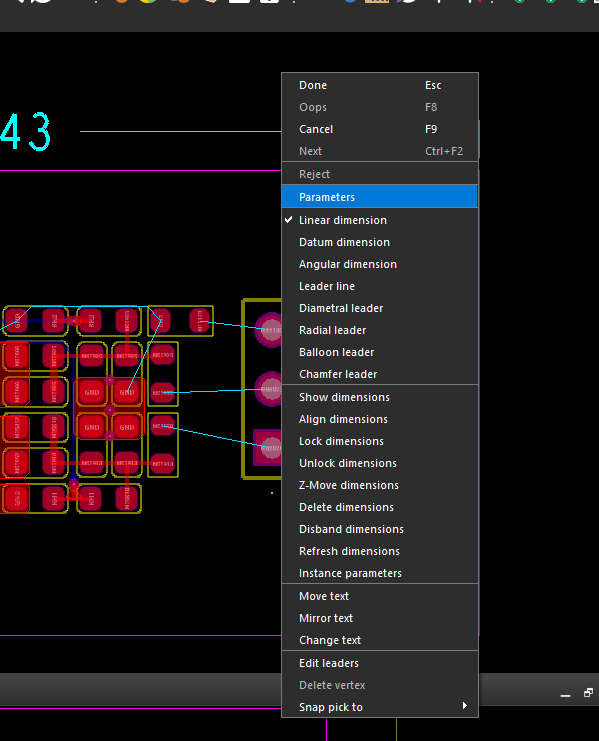
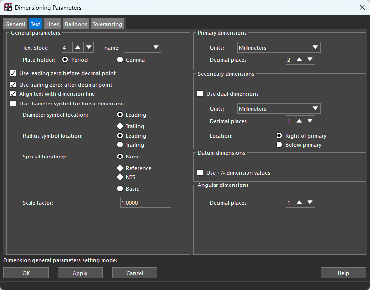
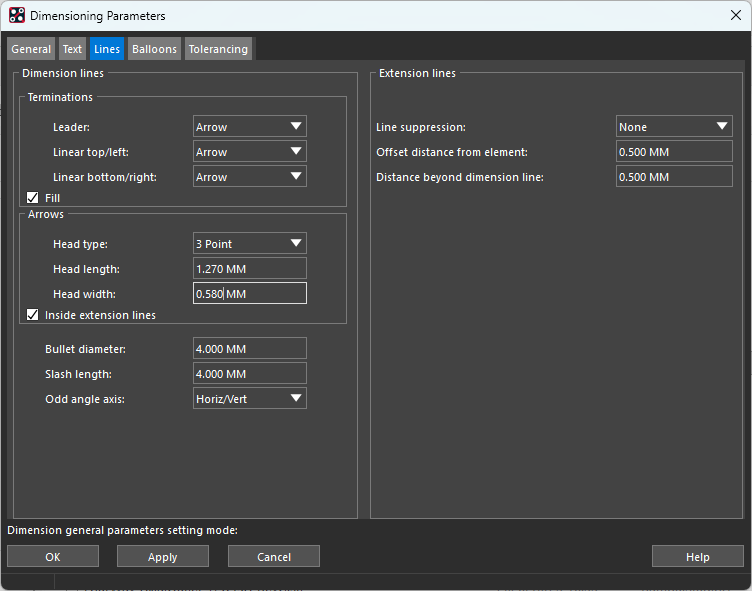

## 1 字号

打开 **Setup → Design Parameters → Text → Setup Text Sizes**，设置文字样式。下图工作单位为 **mil**。

### 1.1 参数含义

| 参数 | 含义 |
|---|---|
| Text Blk | 文字样式编号，不是固定字号；使用文字时在 Options 中选择对应编号 |
| Width | 单个字符的宽度，不是笔画粗细 |
| Height | 单个字符的高度 |
| Line Space | 上一行字符底部到下一行字符顶部的空白距离；单行文字不受影响 |
| Photo Width | 字符笔画宽度，用于显示和光绘输出；生产文字应设置明确的非零值 |
| Char Space | 相邻字符之间的间距 |
| Name | 样式名称，可用于区分引脚号、位号、尺寸标注等用途 |

### 1.2 常用尺寸

以下是图中前五组的参考配置，**单位全部为 mil，编号为自行分配，并非 Allegro 默认标准**。

| Text Blk | 参考用途 | Width | Height | Line Space | Photo Width | Char Space |
|---|---|---:|---:|---:|---:|---:|
| 1 | PIN_NUMBER，仅供设计查看的小引脚号 | 15 | 20 | 5 | 3 | 3 |
| 2 | 密集区域的小位号，需核对高精字符工艺 | 20 | 32 | 8 | 4 | 5 |
| 3 | 普通器件位号：R1、C1、U1 | 25 | 40 | 10 | 6 | 6 |
| 4 | 接口、电源名称，也可用于尺寸标注 | 40 | 60 | 15 | 8 | 8 |
| 5 | 板名、版本号等较大的说明文字 | 50 | 80 | 20 | 10 | 10 |

普通丝印可优先采用 **字高 40 mil、字宽 25 mil、笔画宽 6 mil**；更小的文字需核对板厂能力。PIN_NUMBER 若输出到生产丝印层，同样需要满足字符加工要求。

修改某个 Text Blk，会影响当前设计中所有引用该编号的文字。只修改部分文字时，先 **Add** 新样式，再通过 **Edit → Change**，在 Options 中选择新 Text Block 并应用到目标文字。

## 2 尺寸标注

### 2.1 创建和编辑

打开 **Manufacture → Dimension Environment**，进入尺寸标注环境。

在画布中右击，选择需要的标注或编辑功能。

| 菜单 | 作用 |
|---|---|
| Parameters | 设置标注默认参数，建议在新建标注前配置 |
| Linear dimension | 线性尺寸，常用于板框长宽、孔距、器件距离 |
| Datum dimension | 从统一基准标注各位置的尺寸 |
| Angular dimension | 角度标注 |
| Leader line / Diametral leader / Radial leader | 普通引线、直径引线、半径引线标注 |
| Balloon leader / Chamfer leader | 编号气泡、45°倒角标注 |
| Align dimensions | 以第一个尺寸为基准，对齐后续选择的尺寸 |
| Delete dimensions | 删除标注，不删除被标注对象 |
| Instance parameters | 修改已有单个标注的参数 |
| Move text / Change text | 移动标注文字／修改显示内容；手动改数值不会改变实际几何尺寸 |
| Refresh dimensions | 刷新关联尺寸，使显示与当前关联对象一致 |
| Disband dimensions | 将标注拆成独立文字和图形，拆分后失去原来的关联编辑能力 |

**常用步骤：**右击 Parameters 设置样式 → 选择 Linear dimension → 拾取两个被测点 → 移动鼠标确定尺寸线位置并单击 → 右击 Done 结束。拾取时使用对象捕捉，避免只点到附近栅格。

### 2.2 Text：文字、单位和数值格式

普通 PCB 外形尺寸可按下表设置。

| 选项 | 建议设置与作用 |
|---|---|
| Text block | 选择标注专用样式；图中选 4，对应前文 40 × 60 mil、笔画宽 8 mil。若觉得偏粗，可另建笔画宽 6 mil 的样式 |
| Place holder | **Period**，小数点使用 `.`；Comma 则使用逗号 |
| Use leading zero before decimal point | **勾选**，小于 1 时显示 `0.50`，而不是 `.50` |
| Use trailing zeros after decimal point | **勾选**，保留末尾零，例如统一显示 `43.20` |
| Align text with dimension line | **勾选**，文字方向跟随尺寸线；若希望文字始终横向阅读，可取消 |
| Use diameter symbol for linear dimension | 普通长度**不勾选**，避免在板框长宽前添加直径符号 |
| Diameter symbol location | **Leading**，直径符号在前，例如 `Ø3.00`；Trailing 为放在后面 |
| Radius symbol location | **Leading**，半径符号在前，例如 `R2.00` |
| Special handling | **None** 为普通尺寸；Reference 为参考尺寸（括号），NTS 为非按比例尺寸（下划线），Basic 为基本尺寸（方框） |
| Scale factor | **1.0000**，保持实际测量值；不要通过它调整字体大小 |
| Primary dimensions → Units | **Millimeters**，主尺寸显示为 mm |
| Primary → Decimal places | **2**，显示两位小数，例如 `43.21`；这不代表加工公差 |
| Use dual dimensions | 通常**不勾选**；需要同时显示两种单位时启用 |
| Secondary dimensions | 双单位启用后设置副单位和小数位；Right of primary 放在主尺寸右侧，Below primary 放在下方 |
| Use +/- dimension values | 普通长度**不勾选**；用于基准尺寸相对基准点的正负方向，不是设置 ± 公差 |
| Angular → Decimal places | **1**，角度显示一位小数 |

这里的 **Millimeters 只控制标注数值，不会修改 PCB 的工作单位**。需要加工公差时，在 **Tolerancing** 页单独设置。

### 2.3 Lines：箭头和尺寸界线

箭头过长、尺寸界线伸出过多，会让标注显得笨重。图中已缩短箭头和界线，可以在此基础上微调。

| 参数 | 含义与建议 |
|---|---|
| Leader | 引线标注的端点样式，通常选 **Arrow** |
| Linear top/left | 线性标注上侧／左侧的端点样式，选 **Arrow** |
| Linear bottom/right | 线性标注下侧／右侧的端点样式，选 **Arrow** |
| Fill | **勾选**，将三角箭头填充为实心 |
| Head type | 选 **3 Point**，使用三点三角箭头 |
| Head length | 箭头长度，建议先用 **1.27 mm＝50 mil** |
| Head width | 箭头宽度，建议先用 **0.508 mm＝20 mil**；图中为 0.580 mm，稍宽一些，也可保留 |
| Inside extension lines | 勾选时将箭头放在两条尺寸界线之间；空间不足时可改为外侧 |
| Bullet diameter | **圆点端点的直径**，仅在对应端点选择 Bullet 时生效；当前选择 Arrow，不用调整 |
| Slash length | **斜杠端点的长度**，仅在对应端点选择 Slash 时生效；当前选择 Arrow，不用调整 |
| Odd angle axis | **Horiz/Vert** 表示按水平／垂直方向测量；Odd Axis 用于斜向两点间距离 |
| Line suppression | **None** 表示两侧尺寸界线都显示；也可隐藏其中一侧或两侧 |
| Offset distance from element | 尺寸界线起点与被测对象的空隙，建议 **0.5 mm，约 20 mil** |
| Distance beyond dimension line | 尺寸界线超过尺寸线的长度，建议 **0.5 mm，约 20 mil** |

尺寸线粗细在 **General → Line Width** 设置，可先用 **3 mil（0.0762 mm）**；文字笔画粗细由所选 Text Blk 的 **Photo Width** 控制。

**注意单位：**箭头、尺寸界线等参数按 General 页的 **Parameter Editing Units（mm 或 inches）** 输入，不要把 mil 数值直接填入 mm 字段。例如 50 mil 应填 `1.27 mm` 或 `0.050 inch`。Line Width 则按设计单位填写。

### 2.4 已有标注没有变化怎么办

在尺寸标注环境中，右击 **Instance parameters**，按提示选择已有标注，修改其 Text、Lines 等参数后应用。只改变默认 Parameters，不一定会覆盖已有标注的实例设置。

若只需改变已有标注的文字尺寸，可调整它引用的 Text Blk；但同一编号的其他文字也会一起改变。建议将尺寸标注与器件丝印分配到不同的 Text Blk。
