Gerber 描述各层的铜、阻焊、丝印等图形；实际圆孔和槽孔加工数据分别通过 **NC Drill、NC Route** 输出。制板资料需要一起整理，不能只提交几张铜层文件。

## 1 配置 Artwork 菲林

打开 **Manufacture → Artwork**，在 **Film Control** 中配置。一个 Film（菲林）对应一份输出图形，可包含多个 Class／Subclass；名称可自行定义，实际内容由其下面的层条目决定。

### 1.1 给已有菲林添加 Class／Subclass

展开 TOP 或 BOTTOM，**右击下面的子条目**，例如 `VIA CLASS/BOTTOM`，选择 **Add**。

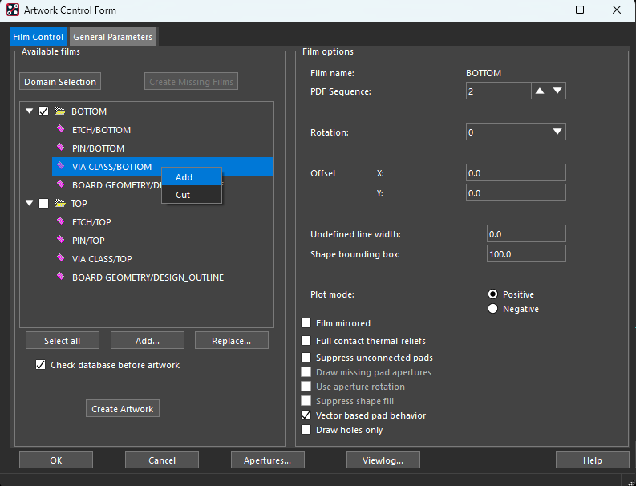

在 **Subclass Selection** 中展开所需 Class，勾选 Subclass，点击 **OK**。例如添加板框时选择实际绘制板框的 `BOARD GEOMETRY/DESIGN_OUTLINE`；尺寸标注则选择 `BOARD GEOMETRY/DIMENSION`。

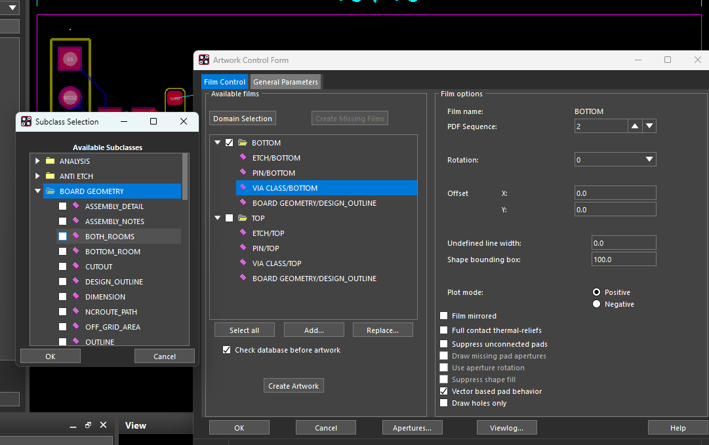

| 操作入口 | 作用 |
|---|---|
| 右击菲林下的 Class／Subclass → Add | 给现有菲林添加层 |
| 右击子条目 → Cut | 从该菲林移除层，不会删除 PCB 中的图形 |
| 右击 TOP 等菲林文件夹 → Add Manual | 手动新建菲林，命名后勾选需要的层 |
| 右击菲林文件夹 → Add | 按当前画布可见层创建新菲林；不同版本菜单显示可能略有差异 |
| 窗口下方 Add… / Replace… | 导入已保存的菲林配置文件／替换所选菲林 |

### 1.2 按可见层创建菲林

先在 **Display → Color/Visibility** 关闭无关层，只显示此次需要输出的层，再到 Artwork 中右击菲林文件夹，选择按当前显示创建的 **Add** 并命名。创建后展开检查，误加的层用 **Cut** 移除，缺少的层用子条目右键 **Add** 补上。

下图的 `PASTOP` 包含顶层钢网开口：`PIN/PASTEMASK_TOP` 和 `PACKAGE GEOMETRY/PASTEMASK_TOP`。

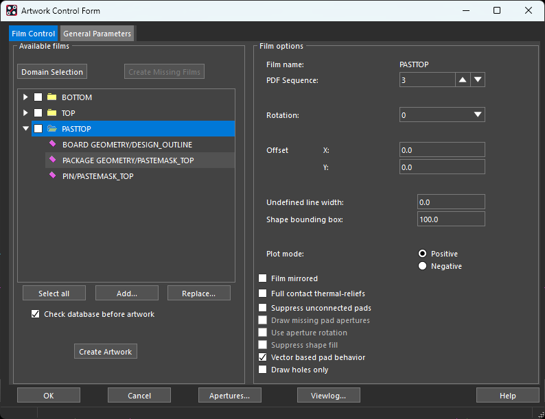

**可见层只用于这种创建方式的初始取层；已有菲林不会随着画布显隐自动同步。** 导出前应检查菲林树，不能只看屏幕上显示了什么。

### 1.3 常见菲林包含哪些层

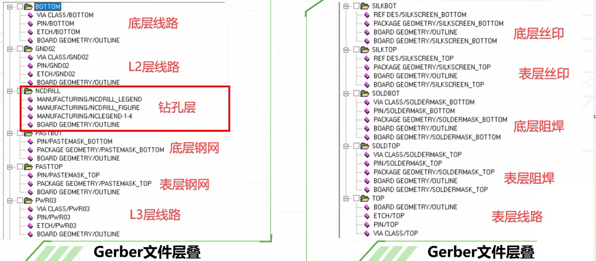

| 菲林用途 | 常见名称 | 主要 Class／Subclass |
|---|---|---|
| 顶层铜 | TOP | `ETCH/TOP`、`PIN/TOP`、`VIA CLASS/TOP` |
| 底层铜 | BOTTOM | `ETCH/BOTTOM`、`PIN/BOTTOM`、`VIA CLASS/BOTTOM` |
| 内层铜 | 按实际层名，如 GND02、PWR03 | 对应层的 `ETCH`、`PIN`、`VIA CLASS`；四层板不能遗漏两个内层 |
| 顶层阻焊开窗 | SOLDTOP | `PIN/SOLDERMASK_TOP`、`VIA CLASS/SOLDERMASK_TOP`，以及实际使用的 `PACKAGE GEOMETRY`、`BOARD GEOMETRY` 下同名子层 |
| 底层阻焊开窗 | SOLDBOT | 对应的 `SOLDERMASK_BOTTOM` 子层 |
| 顶层钢网 | PASTOP | `PIN/PASTEMASK_TOP`、`PACKAGE GEOMETRY/PASTEMASK_TOP`，以及其他实际绘制开口的同名子层 |
| 底层钢网 | PASTBOT | 对应的 `PASTEMASK_BOTTOM` 子层 |
| 顶层丝印 | SILKTOP | `REF DES/SILKSCREEN_TOP`、`PACKAGE GEOMETRY/SILKSCREEN_TOP`、`BOARD GEOMETRY/SILKSCREEN_TOP` |
| 底层丝印 | SILKBOT | 对应的 `SILKSCREEN_BOTTOM` 子层 |
| 板框及内部铣空 | OUTLINE | 实际板框层，通常为 `BOARD GEOMETRY/DESIGN_OUTLINE`；旧设计可能使用 OUTLINE，内部开口也需明确表达 |
| 钻孔说明图 | NCDRILL | `MANUFACTURING/NCDRILL_FIGURE`、`NCDRILL_LEGEND` 和实际生成的各层对钻孔表子层，配合板框 |
| 装配图 | ADT / ADB | 对应面的 `PACKAGE GEOMETRY/ASSEMBLY_TOP` 或 BOTTOM、`REF DES/ASSEMBLY_TOP` 或 BOTTOM，按需加入板框和 DIMENSION |

图中旧模板把 OUTLINE 加入多张菲林；**建议单独输出板框菲林**，不要把尺寸、钻孔表等说明图形混入正式铜层、阻焊或钢网开口数据。底层制板数据通常保持 **Film mirrored 不勾选**，不要仅因名称带 BOTTOM 就镜像。

阻焊菲林表示开窗区域；盖油过孔没有阻焊开窗属于正常情况。**NCDRILL 是钻孔说明图，不能代替实际的 `.drl` 钻孔文件。**

## 2 钻孔和槽孔

### 2.1 Drill Legend：生成钻孔表

打开 **Manufacture → NC → Drill Legend**，设置钻孔表后点击 OK，将表格放到板框外侧。它用于说明孔径、数量、镀铜属性等；需要修改孔符号时使用 **Drill Customization**。

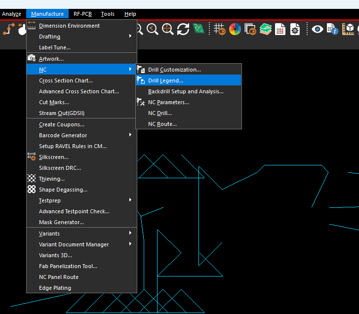

生成后，把对应的 `MANUFACTURING` 钻孔符号和表格子层加入 NCDRILL 菲林；盲埋孔可能有多张不同层对的钻孔表，按实际结果选择。

### 2.2 NC Drill：输出圆孔加工文件

打开 **Manufacture → NC → NC Drill**，设置输出名称，点击 **Parameters…** 配置 NC 参数，再返回点击 **Drill**。输出通常为 `.drl`，具体名称以生成结果为准。

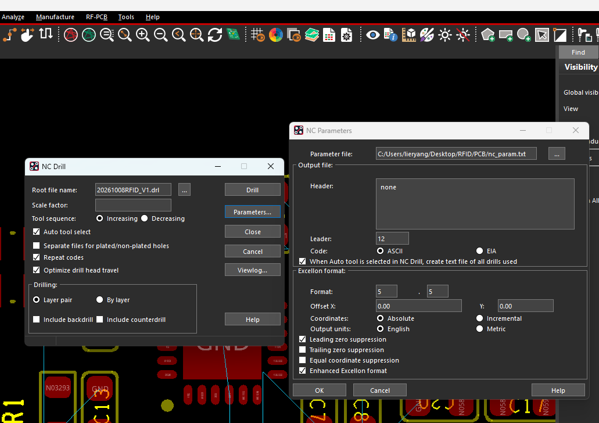

| 参数 | 含义及设置要点 |
|---|---|
| Root file name | 输出文件名，可通过路径按钮指定位置 |
| Scale factor | 孔坐标缩放比例，保持实际比例 1:1，不要用它换算单位 |
| Auto tool select | 自动分配刀具编号，通常勾选 |
| Separate files for plated/non-plated holes | 将镀铜孔 PTH 与非镀铜孔 NPTH 分开输出；需要区分交付时勾选，并提交全部生成文件 |
| Repeat codes | 使用重复孔指令压缩数据；按板厂／查看器支持情况选择 |
| Optimize drill head travel | 优化钻孔行程，通常可勾选 |
| Layer pair | 按实际起止层对输出，普通通孔板通常选它；四层通孔对应 1–4 |
| Include backdrill / counterdrill | 仅设计存在背钻／沉孔等结构时启用 |

**NC Parameters 中的主要设置：**

| 参数 | 含义及设置要点 |
|---|---|
| Code | **ASCII**，便于常用 CAM 软件识别 |
| Format | 坐标整数位数／小数位数；图中为 **5.5**，不是固定必选，需与接收方和查看器设置一致 |
| Offset X / Y | 通常均为 **0**，保持与 Gerber 相同原点 |
| Coordinates | 通常选 **Absolute**，输出绝对坐标 |
| Output units | 图中为 **English（inch）**，Metric 为 mm；English 不是 mil，不能按 mil 数值读取 |
| Leading / Trailing zero suppression | 省略坐标前导零／末尾零；图中仅勾选 Leading，导入查看器时必须匹配 |
| Equal coordinate suppression | 省略重复坐标分量；无特别要求时可不勾选 |
| Enhanced Excellon format | **建议勾选**，输出含单位和刀具直径等信息的文件头 |
| Parameter file | NC 配置文件 `nc_param.txt`，不是交给板厂加工的钻孔数据 |

生成后查看日志，检查刀具直径、孔数量和输出层对。Gerber 与钻孔的原点、单位解释必须对应，否则叠加查看时会偏移或缩放错误。

### 2.3 NC Route：输出槽孔加工文件

有长圆槽、矩形槽或已定义的铣削路径时，打开 **Manufacture → NC → NC Route**，配置 Parameters 后点击 **Route**，通常输出 `.rou` 文件；镀铜槽和非镀铜槽也可分开输出。

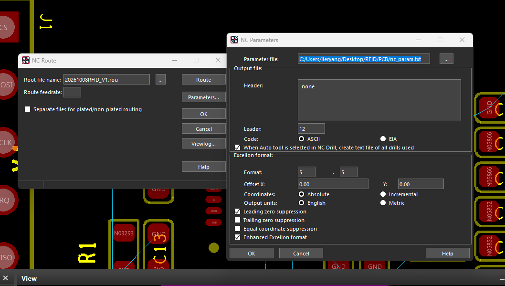

**NC Drill 处理圆孔，NC Route 处理槽孔／铣削路径。** 只有设计中真正定义的槽孔或路径才会生成加工数据，单纯画一个外观矩形不会自动成为槽孔。没有槽孔时，不必为了凑文件生成空的 `.rou`。

## 3 检查并输出 Gerber

### 3.1 数据库检查

打开 **Tools → Database Check**，检查数据库完整性。

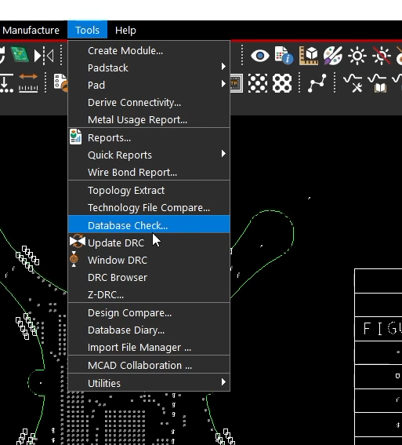

按图勾选 **Update all DRC（including Batch）**、**Check shape outlines**、**Regenerate Xnets**，点击 **Check**，完成后查看日志并处理报告的问题。数据库检查与设计 DRC 检查用途不同，不能互相替代。

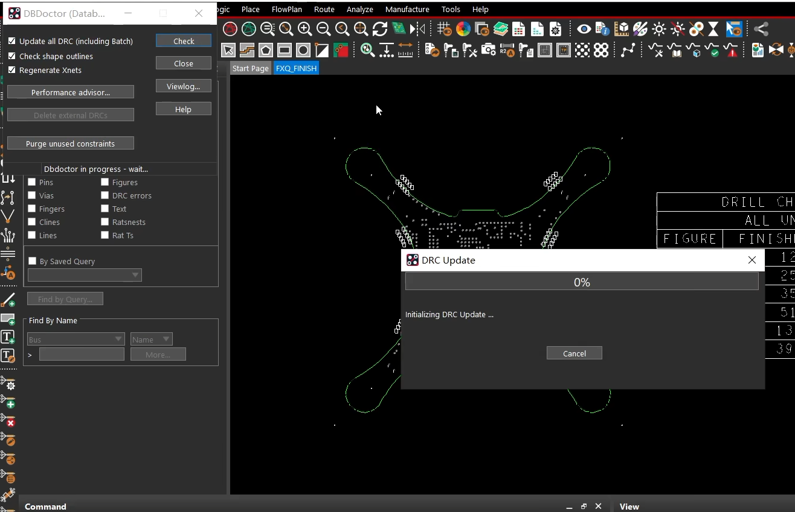

### 3.2 检查 Status

打开 **Display → Status**，确认放置、连接和铺铜状态。

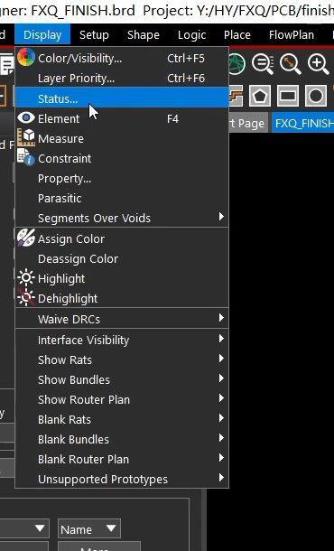

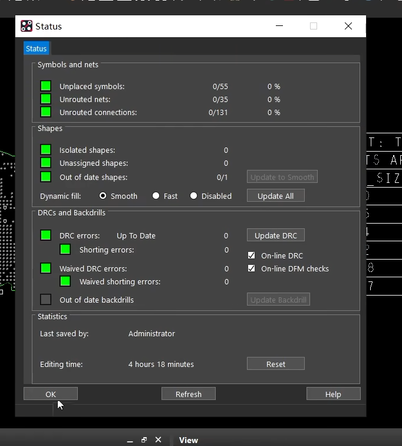

| 检查项 | 输出前确认 |
|---|---|
| Unplaced symbols | 应放置器件均已放置；有未放置项时核实原因 |
| Unrouted nets / connections | 需要连接的网络已完成；未连接项逐项确认 |
| Isolated / Unassigned shapes | 无非预期孤岛和无网络铜皮 |
| Out of date shapes | 为 **0**；动态铺铜恢复 **Smooth** 并执行 Update All |
| DRC errors / Shorting errors | 更新至 **Up To Date**，处理违规；豁免项需单独核实 |

图中的绿色状态表示检查结果正常，但仍需结合具体规则和后续输出预览确认。

### 3.3 Create Artwork：生成菲林

返回 **Manufacture → Artwork**，展开核对各菲林包含的层。在 **General Parameters** 中选择与板厂约定的格式，常用 **Gerber RS274X**；再勾选需要输出的菲林，点击 **Create Artwork**。

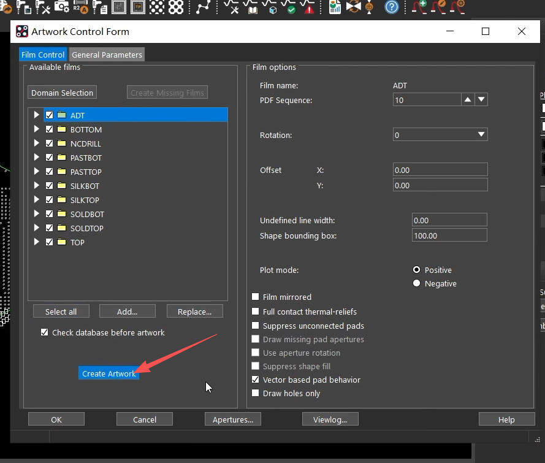

常用 Film Control 设置如下：

| 参数 | 设置要点 |
|---|---|
| Rotation / Offset X、Y | 通常为 **0 / 0、0**，与钻孔数据保持一致 |
| Plot mode | 普通常见正片输出选 **Positive**；负片工艺按实际配置 |
| Film mirrored | 制板数据通常不勾选；装配图镜像显示另行处理 |
| Undefined line width | 为零线宽对象指定输出宽度；图中为 0，若有零线宽文字或图形，应明确其宽度或设置合适值，不能把 0 理解成不输出 |
| Check database before artwork | 勾选，输出前检查数据库完整性 |
| Vector based pad behavior | 图中已勾选，通常保持；不要为消除警告随意改变焊盘输出行为 |

已勾选的菲林才会输出，**Select all** 之前先确认列表中没有无关测试菲林。普通输出文件通常为 `<菲林名>.art`，以实际输出目录和日志为准。

### 3.4 查看输出日志

完成后点击 **Viewlog…**，检查各层的生成结果。

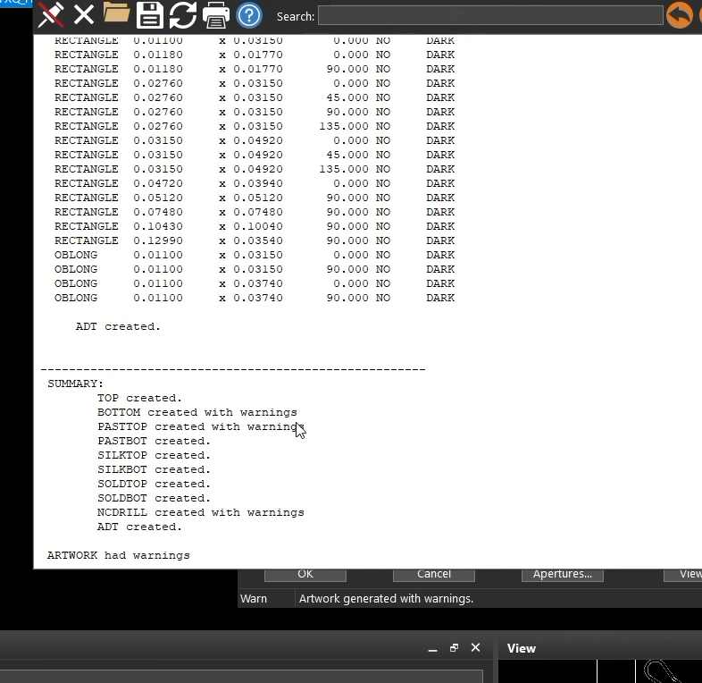

- **created**：该菲林已生成。
- **created with warnings**：已生成但存在警告，需要查看前面的具体原因；不等于可以直接忽略。
- **error / failed**：输出失败，处理后重新生成。

用 Gerber／CAM 查看器加载全部 `.art`、`.drl` 和存在的 `.rou`，叠加检查板框、孔位、内层、阻焊开窗及丝印。重点确认原点一致、没有漏层，盖油和开窗符合设计。

## 4 IPC 网表、坐标文件、装配 PDF

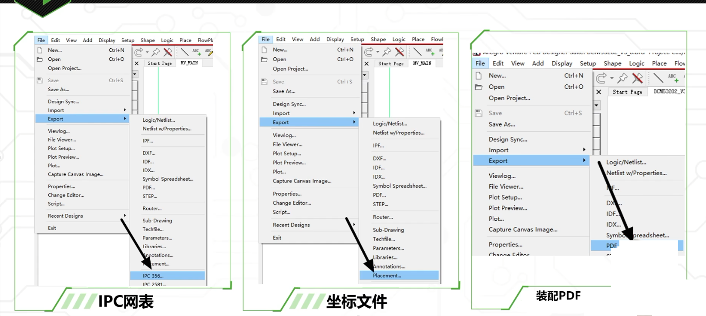

| 文件 | 菜单及步骤 | 用途与核对内容 |
|---|---|---|
| IPC 电测网表 | **File → Export → IPC 356…**，按要求选择 IPC-D-356A 等格式并 Export，通常生成 `.ipc` | 用于板厂电测和网络比对；不是完整制造数据 IPC-2581，也不能代替 Gerber |
| 器件坐标 | **File → Export → Placement…**，选择坐标基准及输出范围后导出 | 用于贴片定位；核对位号、X/Y、旋转角、顶底面和单位，Body Center／Symbol Origin 等基准应按装配方要求选择 |
| 装配 PDF | **File → Export → PDF…**，选择装配用菲林／输出层并导出 | 通常分别准备顶、底面装配图，包含位号、器件轮廓、板框及必要尺寸；如需底视图应注明视图方向 |

装配 PDF 中的显示镜像与正式铜层 Gerber 的输出镜像是两件事，不要为了制作底视装配图而改动底层制板数据。

提交前将 **各铜层、阻焊、丝印、独立板框、圆孔及槽孔数据（如有）** 整理为同一版本。钢网文件用于钢网制作；委托贴片时，再提供 BOM、器件坐标和装配图。文件名和说明中明确层名、版本及特殊加工要求。
