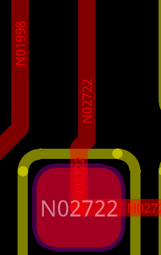
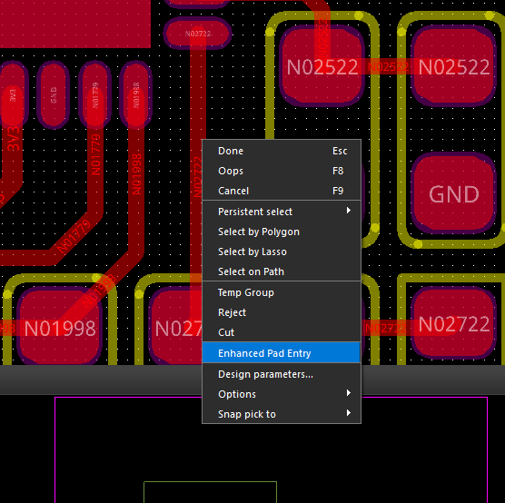
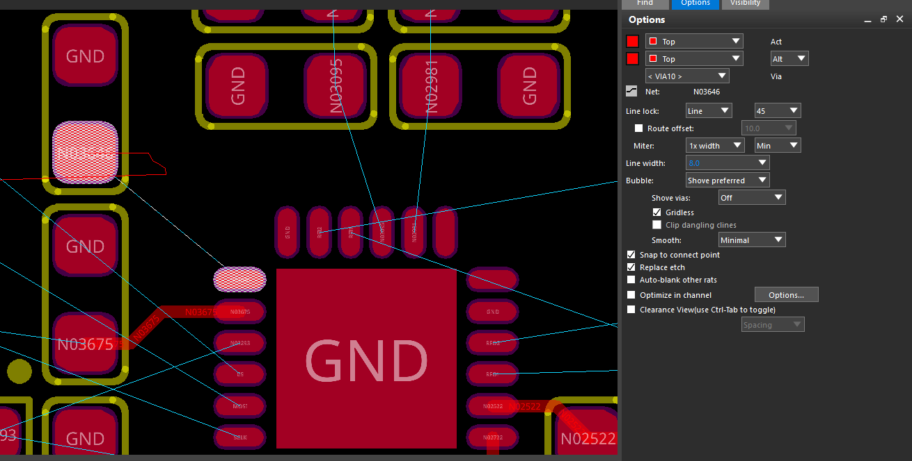
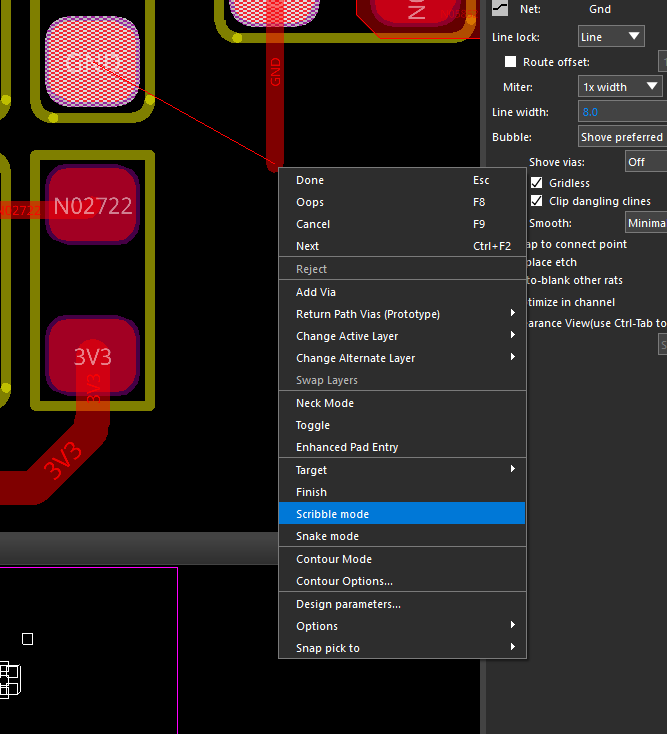

## 1 焊盘入口有小斜段，如何将走线修直？

**现象：** 竖直走线进入焊盘前留有一小段斜线，使用 Slide 后仍无法将它推入焊盘。

**原因：** Enhanced Pad Entry（增强焊盘入口）会调整走线进入、离开焊盘的角度。当两端焊盘中心存在横向偏移时，可能因此保留入口处的小斜段；仅将 Smooth 设为 Full 不一定能消除。

**操作步骤：**

1. 执行 **Slide**，右键找到 **Enhanced Pad Entry**，将其关闭。
2. 选中焊盘上方的短斜段，向下滑入焊盘内部，单击确认。
3. 右键 **Done** 结束，检查焊盘外的走线是否已垂直。

若右键找不到该选项，可进入 **Setup → User Preferences → Route → Connect**，勾选 **`options_no_enhanced_padentry`**，应用后重新执行 Slide。该参数带有 `no`，**勾选表示关闭增强焊盘入口**。

这里的目标是将转折移入焊盘，使焊盘外的走线呈直线；无需为此移动器件，也不要求两端焊盘中心的 X 坐标完全相同。

## 2 布线时只显示红色细线，确认后才出现实际走线

**现象：** 从焊盘拉出走线时，只看到随鼠标移动的红色细线路径，连接到目标焊盘并确认后，才生成具有实际线宽的铜线。

**原因：** 进入了 **Scribble Mode（涂鸦布线模式）**。该模式先记录鼠标绘制的引导路径，再由软件计算并生成实际走线。

**操作步骤：**

1. 保持 **Add Connect（添加走线）** 命令，右键关闭 **Scribble mode**。
2. 也可在布线过程中按 **Tab**，切换普通布线与 Scribble 模式。
3. 切回普通布线后，移动鼠标即可看到具有实际线宽的走线预览，再单击确定拐点或连接目标焊盘。

日常逐段布线使用普通模式；需要先描画大致路径、让软件计算走线路径时，可使用 Scribble 模式。
